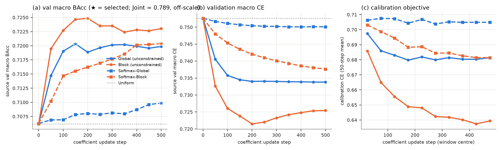
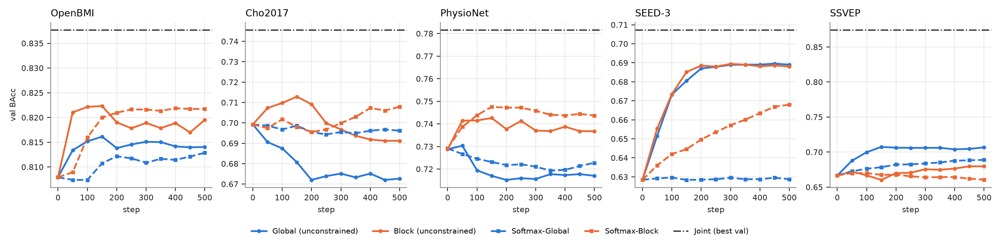
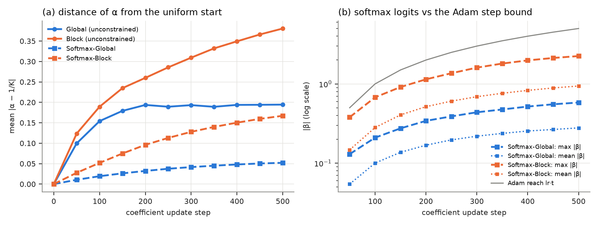
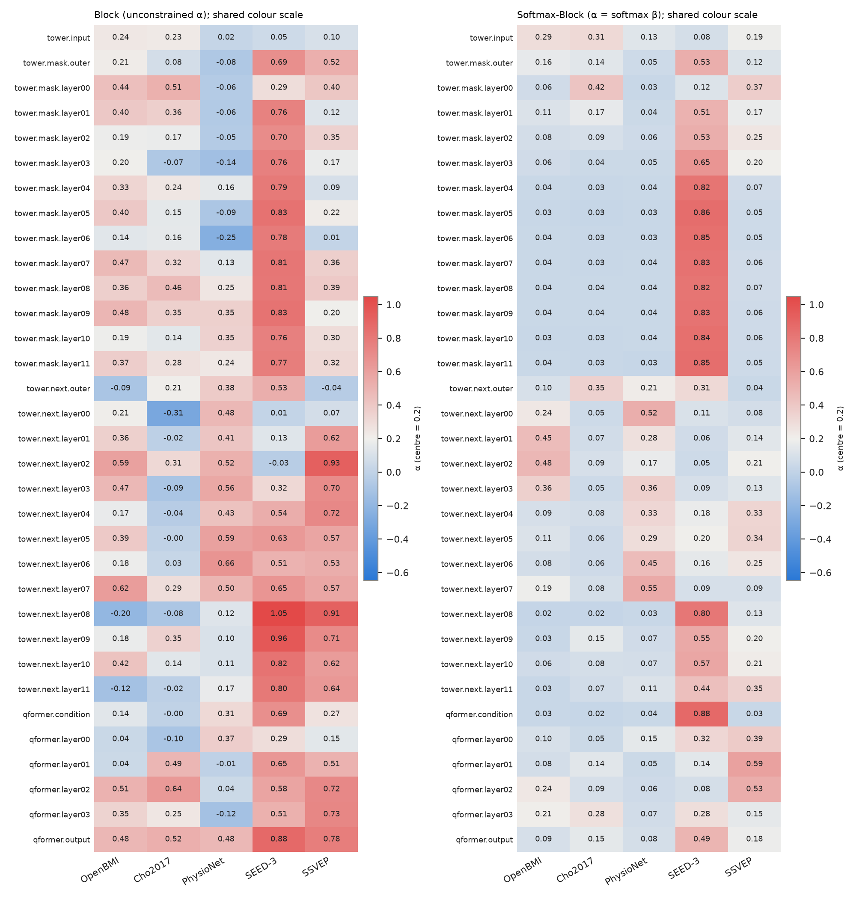

# LEAF POC, Round 2 — Direct Weighted Model Averaging with Softmax

Run date: 2026-11-04. Plan: `/home/jingzhou/BFM-merge/Model_softmax_merging_POC.md`.
Code: `/home/jingzhou/BFM-merge/LEAF`, branch `poc-model-merging` (uncommitted).
Experts, Joint, Uniform, Global and Block are the **existing `runs/poc` checkpoints** (5 datasets, 1,000 steps per dataset, seed 0). Nothing was retrained.
Tables are generated by script from the run artifacts.

---

## 0. TL;DR

- **Softmax (convex) merging did not improve over unconstrained task-vector merging.**
  - Official test (`c_direct_inference.py`, level 2), source macro BAcc: Softmax-Global **0.6923** vs Global 0.6977 (−0.54 pp); Softmax-Block **0.6968** vs Block 0.7015 (−0.47 pp).
  - Validation, the supplementary protocol and all three instruction levels point the same way. The test differences are small (one seed).
- **Block-wise still beats global, by a small margin:** Softmax-Block − Softmax-Global = +0.45 pp test and +1.05 pp validation, on 4/5 datasets. SSVEP is again the exception (−3.54 pp), as it was for the unconstrained pair (+0.38 pp, SSVEP −5.29 pp).
- **Neither new method approaches Joint:** they are −6.77 pp and −6.32 pp below it, below Joint on every source dataset, and 3.1–4.1 pp below Joint on external Weibo.
- **SSVEP and PhysioNet:** softmax does not reduce the SSVEP loss (Softmax-Block 0.6000 is the worst merge on SSVEP). On PhysioNet, Softmax-Block reaches 0.7062 (−3.91 pp vs Joint), which is the best merge but only +0.30 pp over Block.
- **Why the constraint hurts (interpretation):**
  - The unconstrained optimizers pushed the coefficient sum well above 1 (Global Σα = 1.68; block regions 1.6–1.9).
  - The experts' task vectors are nearly orthogonal (cos ≤ 0.18), so raising one expert's weight costs the others little.
  - The softmax forbids Σα > 1, which makes the experts' weights a zero-sum trade.
  - Softmax-Global barely left uniform (max |α − 0.2| = 0.087), and its validation CE flattened by step 300.
- **Remaining bottleneck (hypothesis):** it is not how the coefficients are parametrized. All five merges sit within 1.12 pp of each other, while the Uniform → Joint gap is 7 pp. A per-block scalar mix of near-orthogonal expert updates keeps only a fraction of each expert's gain, and SSVEP alone makes up 41–62 % of the summed per-dataset gap to Joint.

---

## 1. What was run

### 1.1 Methods (new: rows 4–5)

| # | Method | Composition | Coefficients | # coeffs |
|---|---|---|---|---:|
| 1 | Uniform (previous) | θ₀ + Σ_k (1/K) δ_k | fixed | 0 |
| 2 | Global (previous) | θ₀ + Σ_k α_k δ_k | unconstrained real, init 1/K | 5 |
| 3 | Block (previous) | θ₀ᵍ + Σ_k α_{k,g} δ_kᵍ | unconstrained real, init 1/K | 165 |
| 4 | **Softmax-Global** | **Σ_k α_k θ_k**, α = softmax(β) | β ∈ ℝ⁵, init 0 (α = 0.2) | 5 |
| 5 | **Softmax-Block** | **Σ_k α_{k,g} θ_kᵍ**, α_{·,g} = softmax(β_{·,g}) | β ∈ ℝ^{5×33}, init 0 | 165 |

- δ_k = θ_k − θ₀.
- For the softmax methods there is no extra division by K: α is non-negative and sums to 1 within each group.

The following are identical to round 1:
- the 33 groups and the 5 experts;
- calibration: 512 per dataset, stratified, seed 0. The index files are byte-identical to `runs/poc/merge_block` (`cmp` and `np.array_equal`: identical);
- Adam with lr 1e-2, batch size 128, 500 steps with one dataset batch per step in equal-frequency rounds;
- validation at step 0 and every 50 steps;
- selection by (macro val BAcc, −macro val CE);
- bf16 autocast for the forward pass, fp32 parameter composition outside autocast, fp32 evaluation;
- BatchNorm frozen; buffers and the 9 unused tensors taken from θ₀. No subtraction is performed on buffers, so the causal mask's −inf is never touched.

The selected coefficients are folded into an ordinary LEAF `merged.ckpt` that loads without the experts. The folded checkpoint was re-validated and gives exactly the selected step's validation BAcc (table C.1).

**Sanity check of the equivalence.** At step 0, softmax(0) = 1/K, so both softmax methods should equal Uniform.
- Val macro BAcc 0.70626 vs Uniform 0.70619, a difference of 7e-5. Val CE 0.7526070 vs 0.7526074.
- The residual is fp32 rounding: Σα_kθ_k vs θ₀ + Σα_kδ_k.

### 1.2 Code changes (minimal, in place)

- **`LEAF/merge_poc.py`:**
  - Adds the `softmax_global` and `softmax_block` choices. For the softmax methods the stacked tensors are the expert parameters θ_k instead of δ_k. The trainable tensor is β (zeros, K×G) and the coefficients are `torch.softmax(beta, dim=0)`. The composition is `tensordot(α[:, g], θ_k)` instead of `θ₀ + tensordot(α[:, g], δ_k)`.
  - Everything else is shared with the original methods: grouping, loading checks, calibration, `functional_call`, validation and selection, folding.
  - New outputs:
    - `logit_history` in `metrics.npz`, alongside the existing `alpha_history`;
    - `best_logits.npy`;
    - `alpha_parametrization`, `composition` and `best_logits` in `run.json`.
  - `uniform`, `global` and `block` are unchanged. Their round-1 outputs were not touched, and the eval reproduction check in Section 2.0 confirms it.
- **`LEAF/eval_poc.py`:** adds `--models` (default: the round-1 set) and the two new model names. The evaluation code is unchanged.
- **`runs/poc/chain_softmax_round2.sh`:** the exact commands that were run, shown below.

```bash
python merge_poc.py --base checkpoints/leaf-v1.0-instruct-mpnet-base.ckpt --experts-dir runs/poc/experts \
  --datasets MI_OpenBMI,MI_Cho2017,MI_PhysioNet,EMO_SEED_3_seg4,SSVEP_OpenBMI --method softmax_global|softmax_block \
  --calibration-per-dataset 512 --steps 500 --eval-every 50 --lr 1e-2 --bs 128 --seed 0 --outdir runs/poc/merge_<method>
python eval_poc.py --base <same> --run-dir runs/poc --datasets <same 5> \
  --models base,joint,uniform,global,block,softmax_global,softmax_block --external MI_Weibo2014 --output runs/poc/results_round2.csv
python c_direct_inference.py --ckpt runs/poc/merge_<method>/merged.ckpt --ds <same 5> --bs 256 --level 0,1,2 \
  --output runs/poc/direct_inference/<method>.csv
```

Runtime: about 2 minutes per softmax merge, the same as the unconstrained merges.

---

## 2. Results

### 2.0 Protocols

- **Official:** `c_direct_inference.py`, frozen model, instruction level 2 (task + mean label prototype), instruction seed 42.
- **Supplementary:** `eval_poc.py`, the same test splits and the training readout. It also gives Kappa, AUROC, wF1, CE and external Weibo.
- **Reproduction check:** `eval_poc.py` re-evaluated the five round-1 models in this run. The maximum absolute BAcc difference from `runs/poc/results.csv` is **0.0000**, so round-1 and round-2 numbers are directly comparable.

### A. Main comparison

**A.1 Official test BAcc, level 2** (Specialist = each expert on its own dataset, 5 models, reference only):

| Model | OpenBMI | Cho2017 | PhysioNet | SEED-3 | SSVEP | Source macro | Δ macro vs Joint (pp) |
|---|---:|---:|---:|---:|---:|---:|---:|
| Base | 0.7354 | 0.7139 | 0.6878 | 0.5890 | 0.5615 | 0.6575 | -10.25 |
| Joint | 0.7819 | 0.7911 | 0.7453 | 0.6882 | 0.7933 | 0.7600 | +0.00 |
| Uniform | 0.7554 | 0.7817 | 0.6807 | 0.6171 | 0.6165 | 0.6903 | -6.97 |
| Global | 0.7525 | 0.7633 | 0.6632 | 0.6439 | 0.6658 | 0.6977 | -6.23 |
| Block | 0.7631 | 0.7728 | 0.7032 | 0.6555 | 0.6129 | 0.7015 | -5.85 |
| Softmax-Global | 0.7548 | 0.7717 | 0.6784 | 0.6212 | 0.6354 | 0.6923 | -6.77 |
| Softmax-Block | 0.7629 | 0.7744 | 0.7062 | 0.6406 | 0.6000 | 0.6968 | -6.32 |
| Specialist (5 experts, reference) | 0.7894 | 0.8083 | 0.7642 | 0.6679 | 0.8362 | 0.7732 | +1.32 |

**A.2 Supplementary protocol (`eval_poc.py`, contents of `results_round2.csv`), test BAcc, including external Weibo:**

| Model | OpenBMI | Cho2017 | PhysioNet | SEED-3 | SSVEP | Source macro | Weibo (ext.) | Δ macro vs Joint (pp) | Δ Weibo vs Joint (pp) |
|---|---:|---:|---:|---:|---:|---:|---:|---:|---:|
| Base | 0.7321 | 0.7094 | 0.6900 | 0.5891 | 0.5523 | 0.6546 | 0.6228 | -10.57 | -2.53 |
| Joint | 0.7819 | 0.7917 | 0.7461 | 0.6866 | 0.7950 | 0.7603 | 0.6481 | +0.00 | +0.00 |
| Uniform | 0.7554 | 0.7828 | 0.6807 | 0.6166 | 0.6119 | 0.6895 | 0.6108 | -7.08 | -3.73 |
| Global | 0.7540 | 0.7617 | 0.6631 | 0.6449 | 0.6629 | 0.6973 | 0.6272 | -6.30 | -2.09 |
| Block | 0.7629 | 0.7739 | 0.7032 | 0.6548 | 0.6127 | 0.7015 | 0.6158 | -5.88 | -3.23 |
| Softmax-Global | 0.7558 | 0.7717 | 0.6796 | 0.6202 | 0.6315 | 0.6917 | 0.6076 | -6.86 | -4.05 |
| Softmax-Block | 0.7637 | 0.7717 | 0.7060 | 0.6423 | 0.5985 | 0.6964 | 0.6171 | -6.39 | -3.10 |
| Specialist (reference) | 0.7890 | 0.8072 | 0.7647 | 0.6671 | 0.8371 | 0.7730 | – | +1.27 | – |

**A.3 Δ vs Joint per dataset (official, level 2, pp):**

| Model | OpenBMI | Cho2017 | PhysioNet | SEED-3 | SSVEP | Source macro |
|---|---:|---:|---:|---:|---:|---:|
| Base | -4.65 | -7.72 | -5.75 | -9.92 | -23.18 | -10.25 |
| Uniform | -2.65 | -0.94 | -6.46 | -7.11 | -17.68 | -6.97 |
| Global | -2.94 | -2.78 | -8.21 | -4.43 | -12.75 | -6.23 |
| Block | -1.88 | -1.83 | -4.21 | -3.27 | -18.04 | -5.85 |
| Softmax-Global | -2.71 | -1.94 | -6.69 | -6.70 | -15.79 | -6.77 |
| Softmax-Block | -1.90 | -1.67 | -3.91 | -4.76 | -19.33 | -6.32 |
| Specialist | +0.75 | +1.72 | +1.89 | -2.03 | +4.29 | +1.32 |

**A.4 Source macro BAcc at all instruction levels (official):**

| Model | Level 0 | Level 1 | Level 2 (main) |
|---|---:|---:|---:|
| Base | 0.6094 | 0.6495 | 0.6575 |
| Joint | 0.7357 | 0.7571 | 0.7600 |
| Uniform | 0.6800 | 0.6892 | 0.6903 |
| Global | 0.6906 | 0.6979 | 0.6977 |
| Block | 0.6953 | 0.7011 | 0.7015 |
| Softmax-Global | 0.6836 | 0.6929 | 0.6923 |
| Softmax-Block | 0.6906 | 0.6974 | 0.6968 |
| Specialist | 0.7689 | 0.7705 | 0.7732 |

The ranking among the merges is the same at all three levels: Block > Global ≥ Softmax-Block > Softmax-Global > Uniform. At level 0, Global and Softmax-Block are tied at 0.6906.

**A.5 Other macro test metrics (supplementary):**

| Model | BAcc | Kappa | AUROC | wF1 | CE |
|---|---:|---:|---:|---:|---:|
| Base | 0.6546 | 0.4123 | 0.7867 | 0.6453 | 0.8106 |
| Joint | 0.7603 | 0.5803 | 0.8554 | 0.7614 | 0.7010 |
| Uniform | 0.6895 | 0.4712 | 0.8087 | 0.6856 | 0.7648 |
| Global | 0.6973 | 0.4766 | 0.8107 | 0.6970 | 0.7516 |
| Block | 0.7015 | 0.4903 | 0.8206 | 0.7031 | 0.7410 |
| Softmax-Global | 0.6917 | 0.4729 | 0.8088 | 0.6881 | 0.7615 |
| Softmax-Block | 0.6964 | 0.4839 | 0.8176 | 0.6951 | 0.7518 |

### Paired comparisons (official level 2, pp; "Datasets improved" counts datasets where the first model is higher; Weibo from the supplementary protocol)

| Comparison | OpenBMI | Cho2017 | PhysioNet | SEED-3 | SSVEP | Macro | Datasets improved | Weibo |
|---|---:|---:|---:|---:|---:|---:|---:|---:|
| Softmax-Block − Softmax-Global | +0.81 | +0.27 | +2.78 | +1.94 | -3.54 | +0.45 | 4/5 | +0.95 |
| Block − Global | +1.06 | +0.95 | +4.00 | +1.16 | -5.29 | +0.38 | 4/5 | -1.14 |
| Softmax-Global − Global | +0.23 | +0.84 | +1.52 | -2.27 | -3.04 | -0.54 | 3/5 | -1.96 |
| Softmax-Block − Block | -0.02 | +0.16 | +0.30 | -1.49 | -1.29 | -0.47 | 2/5 | +0.13 |
| Softmax-Global − Uniform | -0.06 | -1.00 | -0.23 | +0.41 | +1.89 | +0.20 | 2/5 | -0.32 |
| Softmax-Block − Uniform | +0.75 | -0.73 | +2.55 | +2.35 | -1.65 | +0.65 | 3/5 | +0.63 |
| Softmax-Block − Joint | -1.90 | -1.67 | -3.91 | -4.76 | -19.33 | -6.32 | 0/5 | -3.10 |
| Softmax-Global − Joint | -2.71 | -1.94 | -6.69 | -6.70 | -15.79 | -6.77 | 0/5 | -4.05 |

**How large a difference is resolvable.**
- This is one seed. The experts are fixed, so the only randomness is the calibration batch order and the test-set sampling.
- Three-seed reference from the 3,000-step POC (`runs/poc3k`, where the experts differ per seed): macro std was 0.14 pp for Uniform, 0.16 pp for Global and 0.46 pp for Block. There, Block − Global was +1.4 pp on every seed.
- Macro differences of about 0.5 pp here should therefore be read as **direction only, not established**.

---

### B. Global vs Block-wise softmax

**Observations**
- Test: Softmax-Block exceeds Softmax-Global by **+0.45 pp** macro (official) and +0.47 pp (supplementary).
  - It is higher on OpenBMI (+0.81), Cho2017 (+0.27), PhysioNet (+2.78) and SEED-3 (+1.94), and lower on SSVEP (−3.54).
  - Weibo: +0.95 pp.
- Validation: 0.7204 vs 0.7099 (+1.05 pp), and CE 0.7376 vs 0.7501.
- Same pattern for the unconstrained pair: Block − Global = +0.38 pp test, 4/5 datasets, SSVEP −5.29 pp.

**Interpretation**
- Block-wise coefficients help both parametrizations by a similar, small amount.
- In both, the block-wise optimum trades SSVEP for the other datasets. In the per-dataset validation curves (Fig. 2), SSVEP val stays at 0.66–0.68 for both block variants, while Global's rises to 0.707.
- The macro selection criterion accepts this trade because the four other datasets gain more in total.

---

### C. Softmax vs unconstrained merging

**C.1 Validation and selection**

| Method | # coeffs | Parametrization | Selected step | Val BAcc @0 | Best val BAcc | Best val CE | Folded ckpt val BAcc | Val BAcc @500 | Time (s) |
|---|---:|---:|---:|---:|---:|---:|---:|---:|---:|
| Uniform | 5 (fixed) | fixed α = 1/K | 0 | 0.7062 | 0.7062 | 0.7526 | 0.7062 | 0.7062 | 18 |
| Global | 5 | real α, init 1/K | 150 | 0.7062 | 0.7203 | 0.7345 | 0.7203 | 0.7199 | 120 |
| Block | 165 | real α, init 1/K | 200 | 0.7062 | 0.7248 | 0.7215 | 0.7248 | 0.7230 | 122 |
| Softmax-Global | 5 | α = softmax(β), β init 0 | 500 | 0.7063 | 0.7099 | 0.7501 | 0.7099 | 0.7099 | 120 |
| Softmax-Block | 165 | α = softmax(β), β init 0 | 500 | 0.7063 | 0.7204 | 0.7376 | 0.7204 | 0.7204 | 124 |
| Joint (reference) | – | – | round 1000 | – | 0.7894 | 0.6776 | – | – | – |

**C.2 Per-dataset validation BAcc at the selected step**

| Method | OpenBMI | Cho2017 | PhysioNet | SEED-3 | SSVEP |
|---|---:|---:|---:|---:|---:|
| Uniform | 0.8079 | 0.6993 | 0.7288 | 0.6284 | 0.6666 |
| Global | 0.8161 | 0.6807 | 0.7170 | 0.6805 | 0.7073 |
| Block | 0.8190 | 0.7092 | 0.7377 | 0.6885 | 0.6698 |
| Softmax-Global | 0.8129 | 0.6962 | 0.7228 | 0.6287 | 0.6888 |
| Softmax-Block | 0.8217 | 0.7079 | 0.7437 | 0.6680 | 0.6606 |
| Joint (reference) | 0.8377 | 0.7457 | 0.7817 | 0.7074 | 0.8745 |

**C.3 Calibration objective (mean calibration CE over 50-step windows)**

| Method | 0–49 | 50–99 | 100–149 | 150–199 | 200–249 | 250–299 | 300–349 | 350–399 | 400–449 | 450–499 |
|---|---:|---:|---:|---:|---:|---:|---:|---:|---:|---:|
| Global | 0.6974 | 0.6860 | 0.6830 | 0.6798 | 0.6819 | 0.6799 | 0.6814 | 0.6804 | 0.6803 | 0.6814 |
| Block | 0.6858 | 0.6649 | 0.6555 | 0.6488 | 0.6481 | 0.6423 | 0.6418 | 0.6401 | 0.6374 | 0.6394 |
| Softmax-Global | 0.7063 | 0.7075 | 0.7073 | 0.7043 | 0.7068 | 0.7038 | 0.7052 | 0.7049 | 0.7049 | 0.7049 |
| Softmax-Block | 0.7031 | 0.6988 | 0.6944 | 0.6883 | 0.6887 | 0.6844 | 0.6845 | 0.6826 | 0.6814 | 0.6814 |

**C.4 Coefficient summary at the selected step**

| Method | Mean \|α−0.2\| | Max \|α−0.2\| | Min α | Max α | Σ_k α per group | # negative α | Max \|β\| (selected) | Adam reach lr·t |
|---|---:|---:|---:|---:|---:|---:|---:|---:|
| Global | 0.1792 | 0.2865 | +0.0911 | 0.4865 | 1.6781–1.6781 | 0/5 | – | – |
| Block | 0.2600 | 0.8471 | -0.3077 | 1.0471 | 0.4657–3.1264 | 24/165 | – | – |
| Softmax-Global | 0.0521 | 0.0865 | +0.1135 | 0.2696 | 1.0000–1.0000 | 0/5 | 0.582 | 5.00 |
| Softmax-Block | 0.1671 | 0.6760 | +0.0169 | 0.8760 | 1.0000–1.0000 | 0/165 | 2.246 | 5.00 |

"Adam reach lr·t" is the largest |β| Adam can produce: about lr per step per coordinate, times the step count.



*Fig. 1.* (a) Validation macro BAcc; ★ marks the selected step. Joint's best validation BAcc, 0.789, is above the plotted range. (b) Validation macro CE. (c) Calibration CE, 50-step means. Solid lines are unconstrained, dashed lines softmax; blue is global, orange block-wise.



*Fig. 2.* Per-dataset validation BAcc during coefficient optimization. The dash-dot line is Joint's best validation BAcc.



*Fig. 3.* (a) Mean |α − 1/K| over training. (b) Softmax logits against the Adam step bound, on a log scale.

**Observations**
1. **Test.** Each softmax method is below its unconstrained counterpart: −0.54 pp (global) and −0.47 pp (block).
   - Softmax-Global gains on the three MI datasets (+0.23 / +0.84 / +1.52) and loses on SEED-3 (−2.27) and SSVEP (−3.04).
   - Softmax-Block matches Block on the MI datasets (−0.02 / +0.16 / +0.30) and loses on SEED-3 (−1.49) and SSVEP (−1.29).
   - Against Uniform, softmax gains only +0.20 pp (global) and +0.65 pp (block). The unconstrained methods gain +0.74 and +1.12 pp.
2. **Validation.** Softmax is also lower: 0.7099 vs 0.7203 (global) and 0.7204 vs 0.7248 (block). Its validation CE is higher: 0.7501 vs 0.7345, and 0.7376 vs 0.7215.
3. **Softmax-Global hardly moved.**
   - Max |α − 0.2| = 0.087, against 0.287 for Global.
   - Max |β| = 0.58, far below the 5.0 that Adam could reach.
   - Validation CE fell from 0.7526 to 0.7502 by step 300 and was 0.7501 at step 500. Calibration CE stayed between 0.704 and 0.708 throughout.
   - The selected step is the last one (500), but the validation BAcc gain after step 300 is only +0.18 pp.
4. **Softmax-Block is not converged by its own criterion.** The selected step is 500 and validation CE is still falling (0.7401 at step 300, 0.7376 at step 500, −0.0005 over the last 50 steps). Max |β| = 2.25, below the 5.0 bound.
5. **Unconstrained Block overfits the calibration set after step 200.** Validation CE reaches its minimum, 0.7215, at step 200 and rises to 0.7254 by step 500. Over the same window calibration CE keeps falling, from 0.6481 to 0.6394.
6. **The unconstrained solutions lie outside the simplex.**
   - Global: all α > 0, but Σα = 1.678.
   - Block: Σ_k α per group ranges from 0.47 to 3.13. The mean per region is 0.64 for Tower input, 1.63 for the mask branch, 1.80 for the next branch and 1.86 for Q-Former + output (table E.4). 24 of 165 coefficients are negative.
   - Normalizing Global's α to sum to 1 gives (0.243, 0.054, 0.137, 0.290, 0.276). This is at L1 distance 0.19 from the softmax solution (0.261, 0.1135, 0.156, 0.200, 0.270).

**Interpretation: poor convergence vs the constraint**
- **Softmax-Global: mostly the constraint.**
  - The objective plateaued (both CE curves are flat) while β stayed far below what Adam could reach. So the step size did not limit it.
  - A likely mechanism: in step mode each step sees one dataset, and each dataset pushes its own expert's weight up. On the simplex that is zero-sum, so the pushes largely cancel. Without the constraint they need not cancel.
  - The best unconstrained point (Σα = 1.68) is not reachable under softmax at all.
- **Softmax-Block: both factors, the constraint larger.**
  - It is still improving slowly, so longer optimization or a larger LR could narrow the 0.47 pp test gap. That was not run, because the plan forbids tuning.
  - At the current slope, another 500 steps would lower validation CE by only about 0.005. That still leaves it above Block's 0.7215. Its calibration CE (0.681) is also well above Block's (0.639).
  - So under-convergence does not plausibly explain the whole gap.
- **Overall:** in this setting, the convex restriction mildly hurts. It removes the "keep more of every expert" direction (Σα > 1) that the unconstrained optimizers use.

---

### D. Dataset-specific behaviour (SSVEP_OpenBMI and MI_PhysioNet)

**D.1 The two hard datasets (official, level 2)**

| Dataset | Model | Test BAcc (L2) | Δ vs Joint (pp) | Δ vs Uniform (pp) |
|---|---:|---:|---:|---:|
| SSVEP | Base | 0.5615 | -23.18 | -5.50 |
| SSVEP | Uniform | 0.6165 | -17.68 | +0.00 |
| SSVEP | Global | 0.6658 | -12.75 | +4.93 |
| SSVEP | Block | 0.6129 | -18.04 | -0.36 |
| SSVEP | Softmax-Global | 0.6354 | -15.79 | +1.89 |
| SSVEP | Softmax-Block | 0.6000 | -19.33 | -1.65 |
| SSVEP | Joint | 0.7933 | +0.00 | +17.68 |
| SSVEP | Expert[SSVEP] | 0.8362 | +4.29 | +21.97 |
| PhysioNet | Base | 0.6878 | -5.75 | +0.71 |
| PhysioNet | Uniform | 0.6807 | -6.46 | +0.00 |
| PhysioNet | Global | 0.6632 | -8.21 | -1.75 |
| PhysioNet | Block | 0.7032 | -4.21 | +2.25 |
| PhysioNet | Softmax-Global | 0.6784 | -6.69 | -0.23 |
| PhysioNet | Softmax-Block | 0.7062 | -3.91 | +2.55 |
| PhysioNet | Joint | 0.7453 | +0.00 | +6.46 |
| PhysioNet | Expert[PhysioNet] | 0.7642 | +1.89 | +8.35 |

**D.2 Retention of each expert's own gain**

Retention = (model − Base) / (Expert_d − Base) on dataset d, official level 2. 100 % means the model keeps all of what the specialist gained over Base.

| Model | OpenBMI | Cho2017 | PhysioNet | SEED-3 | SSVEP |
|---|---:|---:|---:|---:|---:|
| Uniform | 37% | 72% | -9% | 36% | 20% |
| Global | 32% | 52% | -32% | 70% | 38% |
| Block | 51% | 62% | 20% | 84% | 19% |
| Softmax-Global | 36% | 61% | -12% | 41% | 27% |
| Softmax-Block | 51% | 64% | 24% | 65% | 14% |
| Joint | 86% | 82% | 75% | 126% | 84% |
| Expert gain over Base (pp) | +5.40 | +9.44 | +7.64 | +7.89 | +27.47 |

**D.3 Own-expert coefficient → retention, for the three global-coefficient models**

Format: α of expert d → retention on dataset d.

| Model | OpenBMI | Cho2017 | PhysioNet | SEED-3 | SSVEP |
|---|---:|---:|---:|---:|---:|
| Uniform | 0.200 → 37% | 0.200 → 72% | 0.200 → -9% | 0.200 → 36% | 0.200 → 20% |
| Softmax-Global | 0.261 → 36% | 0.113 → 61% | 0.156 → -12% | 0.200 → 41% | 0.270 → 27% |
| Global | 0.407 → 32% | 0.091 → 52% | 0.231 → -32% | 0.487 → 70% | 0.463 → 38% |

**Observations**
- **SSVEP.**
  - The SSVEP expert gains +27.5 pp over Base, the largest gain of any expert.
  - Merges keep 14–38 % of it; Joint keeps 84 %.
  - Softmax-Global (0.6354) is between Uniform (0.6165) and Global (0.6658). Softmax-Block (0.6000) is the lowest of all merges.
  - SSVEP accounts for 41–62 % (Uniform 51 %, Global 41 %, Block 62 %, Softmax-Global 47 %, Softmax-Block 61 %) of the summed per-dataset gap to Joint, depending on the merge.
  - Softmax does **not** reduce the SSVEP loss: −15.79 pp and −19.33 pp vs Joint, against −12.75 pp and −18.04 pp for the unconstrained methods.
- **PhysioNet.**
  - Softmax-Block 0.7062 is the best merge (−3.91 pp vs Joint, +0.30 pp vs Block).
  - Softmax-Global 0.6784 is better than Global (0.6632, +1.52 pp). Global was the only method that fell clearly below Uniform here. Softmax-Global is still not above Uniform (−0.23 pp).
  - Uniform (0.6807), Global (0.6632) and Softmax-Global (0.6784) are below Base (0.6878) on PhysioNet, so their retention is negative.
- **Where gains come at the expense of others.**
  - Softmax-Global's improvements over Global (MI datasets) come with losses on SEED-3 and SSVEP.
  - Softmax-Block's improvement on PhysioNet over Softmax-Global (+2.78) comes with −3.54 on SSVEP.
- **Dose-response (D.3).** For the two non-MI experts, retention rises with the expert's own coefficient across the three global-coefficient models: SSVEP 20 → 27 → 38 %, SEED-3 36 → 41 → 70 %. Cho2017 falls as its α falls. OpenBMI and PhysioNet do not follow their own α. Only three points each.

**Interpretation (hypothesis)**
- SEED-3 and SSVEP behave as if their test accuracy is set mainly by how much of their own task vector survives.
- The MI experts' updates are aligned with each other in the Q-Former + output region (cos 0.55–0.59; Section E.5). Their accuracy may therefore depend on the combined MI weight rather than on their own α.
- Under the convex constraint SSVEP can gain weight only at the expense of the others. The macro objective did not choose that trade.

---

### E. Learned coefficients

**E.1 Global coefficients**

| Expert | Global α (unconstrained) | Softmax-Global α | Softmax-Global β |
|---|---:|---:|---:|
| OpenBMI | +0.4072 | 0.2607 | +0.2500 |
| Cho2017 | +0.0911 | 0.1135 | -0.5820 |
| PhysioNet | +0.2307 | 0.1564 | -0.2609 |
| SEED-3 | +0.4865 | 0.1999 | -0.0157 |
| SSVEP | +0.4626 | 0.2696 | +0.2834 |
| Σ | 1.6781 | 1.0000 | – |

**E.2 Softmax-Block coefficients (α per group; Argmax = dominant expert; normalized entropy = 1 for uniform, 0 for one-hot)**

| Group | Region | OpenBMI | Cho2017 | PhysioNet | SEED-3 | SSVEP | Argmax | Norm. entropy | Unconstr. argmax | Unconstr. Σα |
|---|---:|---:|---:|---:|---:|---:|---:|---:|---:|---:|
| tower.input | Tower input | 0.291 | 0.306 | 0.133 | 0.082 | 0.188 | Cho2017 | 0.938 | OpenBMI | 0.635 |
| tower.mask.outer | Tower mask branch | 0.162 | 0.136 | 0.053 | 0.529 | 0.120 | SEED-3 | 0.816 | SEED-3 | 1.427 |
| tower.mask.layer00 | Tower mask branch | 0.063 | 0.417 | 0.035 | 0.119 | 0.366 | Cho2017 | 0.793 | Cho2017 | 1.593 |
| tower.mask.layer01 | Tower mask branch | 0.107 | 0.166 | 0.042 | 0.510 | 0.174 | SEED-3 | 0.819 | SEED-3 | 1.575 |
| tower.mask.layer02 | Tower mask branch | 0.077 | 0.089 | 0.055 | 0.530 | 0.248 | SEED-3 | 0.780 | SEED-3 | 1.353 |
| tower.mask.layer03 | Tower mask branch | 0.063 | 0.042 | 0.046 | 0.651 | 0.197 | SEED-3 | 0.652 | SEED-3 | 0.927 |
| tower.mask.layer04 | Tower mask branch | 0.041 | 0.034 | 0.037 | 0.821 | 0.067 | SEED-3 | 0.442 | SEED-3 | 1.610 |
| tower.mask.layer05 | Tower mask branch | 0.033 | 0.027 | 0.030 | 0.860 | 0.050 | SEED-3 | 0.369 | SEED-3 | 1.506 |
| tower.mask.layer06 | Tower mask branch | 0.037 | 0.029 | 0.033 | 0.847 | 0.054 | SEED-3 | 0.395 | SEED-3 | 0.839 |
| tower.mask.layer07 | Tower mask branch | 0.037 | 0.032 | 0.036 | 0.833 | 0.061 | SEED-3 | 0.420 | SEED-3 | 2.094 |
| tower.mask.layer08 | Tower mask branch | 0.039 | 0.039 | 0.040 | 0.817 | 0.066 | SEED-3 | 0.450 | SEED-3 | 2.268 |
| tower.mask.layer09 | Tower mask branch | 0.040 | 0.037 | 0.040 | 0.827 | 0.056 | SEED-3 | 0.434 | SEED-3 | 2.222 |
| tower.mask.layer10 | Tower mask branch | 0.029 | 0.033 | 0.038 | 0.842 | 0.058 | SEED-3 | 0.403 | SEED-3 | 1.740 |
| tower.mask.layer11 | Tower mask branch | 0.037 | 0.031 | 0.027 | 0.854 | 0.052 | SEED-3 | 0.381 | SEED-3 | 1.971 |
| tower.next.outer | Tower next branch | 0.095 | 0.346 | 0.213 | 0.309 | 0.037 | Cho2017 | 0.873 | SEED-3 | 0.982 |
| tower.next.layer00 | Tower next branch | 0.238 | 0.053 | 0.525 | 0.106 | 0.079 | PhysioNet | 0.791 | PhysioNet | 0.466 |
| tower.next.layer01 | Tower next branch | 0.453 | 0.068 | 0.275 | 0.064 | 0.139 | OpenBMI | 0.837 | SSVEP | 1.495 |
| tower.next.layer02 | Tower next branch | 0.481 | 0.090 | 0.173 | 0.050 | 0.206 | OpenBMI | 0.837 | SSVEP | 2.319 |
| tower.next.layer03 | Tower next branch | 0.356 | 0.054 | 0.365 | 0.093 | 0.132 | PhysioNet | 0.858 | SSVEP | 1.954 |
| tower.next.layer04 | Tower next branch | 0.091 | 0.076 | 0.325 | 0.179 | 0.328 | SSVEP | 0.903 | SSVEP | 1.814 |
| tower.next.layer05 | Tower next branch | 0.113 | 0.060 | 0.292 | 0.198 | 0.339 | SSVEP | 0.907 | SEED-3 | 2.184 |
| tower.next.layer06 | Tower next branch | 0.080 | 0.059 | 0.454 | 0.156 | 0.252 | PhysioNet | 0.848 | PhysioNet | 1.913 |
| tower.next.layer07 | Tower next branch | 0.187 | 0.084 | 0.548 | 0.093 | 0.089 | PhysioNet | 0.799 | SEED-3 | 2.626 |
| tower.next.layer08 | Tower next branch | 0.019 | 0.017 | 0.034 | 0.804 | 0.127 | SEED-3 | 0.432 | SEED-3 | 1.805 |
| tower.next.layer09 | Tower next branch | 0.032 | 0.153 | 0.067 | 0.551 | 0.197 | SEED-3 | 0.762 | SEED-3 | 2.302 |
| tower.next.layer10 | Tower next branch | 0.063 | 0.083 | 0.075 | 0.566 | 0.214 | SEED-3 | 0.762 | SEED-3 | 2.106 |
| tower.next.layer11 | Tower next branch | 0.031 | 0.070 | 0.111 | 0.439 | 0.349 | SEED-3 | 0.786 | SEED-3 | 1.471 |
| qformer.condition | Q-Former + output | 0.029 | 0.021 | 0.041 | 0.876 | 0.033 | SEED-3 | 0.338 | SEED-3 | 1.398 |
| qformer.layer00 | Q-Former + output | 0.100 | 0.047 | 0.148 | 0.320 | 0.385 | SSVEP | 0.863 | PhysioNet | 0.747 |
| qformer.layer01 | Q-Former + output | 0.078 | 0.140 | 0.047 | 0.142 | 0.593 | SSVEP | 0.749 | SEED-3 | 1.681 |
| qformer.layer02 | Q-Former + output | 0.239 | 0.091 | 0.056 | 0.082 | 0.531 | SSVEP | 0.786 | SSVEP | 2.483 |
| qformer.layer03 | Q-Former + output | 0.213 | 0.276 | 0.071 | 0.285 | 0.155 | SEED-3 | 0.944 | SSVEP | 1.711 |
| qformer.output | Q-Former + output | 0.091 | 0.152 | 0.081 | 0.491 | 0.184 | SEED-3 | 0.851 | SEED-3 | 3.126 |

**E.3 Region summary, Softmax-Block**

| Region | # groups | mean α OpenBMI | mean α Cho2017 | mean α PhysioNet | mean α SEED-3 | mean α SSVEP | Argmax counts | Mean norm. entropy | Max α |
|---|---:|---:|---:|---:|---:|---:|---:|---:|---:|
| Tower input | 1 | 0.291 | 0.306 | 0.133 | 0.082 | 0.188 | Cho2017×1 | 0.938 | 0.306 |
| Tower mask branch | 13 | 0.059 | 0.086 | 0.039 | 0.695 | 0.121 | Cho2017×1, SEED-3×12 | 0.550 | 0.860 |
| Tower next branch | 13 | 0.172 | 0.093 | 0.266 | 0.278 | 0.191 | OpenBMI×2, Cho2017×1, PhysioNet×4, SEED-3×4, SSVEP×2 | 0.800 | 0.804 |
| Q-Former + output | 6 | 0.125 | 0.121 | 0.074 | 0.366 | 0.313 | SEED-3×3, SSVEP×3 | 0.755 | 0.876 |

**E.4 Same regions, unconstrained Block** (for comparison):

| Region | mean α OpenBMI | mean α Cho2017 | mean α PhysioNet | mean α SEED-3 | mean α SSVEP | mean Σ_k α |
|---|---:|---:|---:|---:|---:|---:|
| Tower input | +0.236 | +0.233 | +0.018 | +0.048 | +0.100 | 0.635 |
| Tower mask branch | +0.321 | +0.243 | +0.058 | +0.736 | +0.267 | 1.625 |
| Tower next branch | +0.245 | +0.059 | +0.387 | +0.532 | +0.581 | 1.803 |
| Q-Former + output | +0.259 | +0.298 | +0.179 | +0.598 | +0.523 | 1.858 |



*Fig. 4.* Block coefficients: unconstrained (left) vs softmax (right), on a shared diverging scale centred at 1/K = 0.2. Per-method heatmaps in the existing format are in `merge_softmax_{global,block}/alpha_heatmap.png`.

**E.5 Task-vector geometry**

Computed on CPU in float64 from the five expert checkpoints, over the merged parameters only.

| Region | cos, MI–MI pairs | max \|cos\|, pairs with SEED-3 or SSVEP | ‖δ‖ OpenBMI | ‖δ‖ Cho2017 | ‖δ‖ PhysioNet | ‖δ‖ SEED-3 | ‖δ‖ SSVEP |
|---|---:|---:|---:|---:|---:|---:|---:|
| All merged parameters | 0.127–0.175 | 0.028 | 10.57 | 12.86 | 11.38 | 11.53 | 12.49 |
| Tower input | 0.029–0.083 | 0.054 | 6.48 | 8.79 | 7.88 | 6.32 | 8.42 |
| Tower mask branch | 0.027–0.075 | 0.029 | 4.22 | 5.01 | 4.20 | 4.96 | 5.32 |
| Tower next branch | 0.032–0.118 | 0.014 | 5.08 | 5.83 | 5.20 | 4.48 | 5.30 |
| Q-Former + output | 0.552–0.591 | 0.007 | 5.12 | 5.39 | 4.76 | 6.96 | 5.37 |

**Observations**
- **Distribution.** The Softmax-Block coefficients are far from uniform.
  - Quantiles: min 0.017, 25 % 0.050, median 0.093, 75 % 0.276, 95 % 0.814, max 0.876.
  - 38 of 165 coefficients are above 0.3, and 84 are below 0.1.
  - Softmax-Global stays near uniform (0.1135–0.270).
- **Domination by SEED-3 in the EEG Tower's mask branch.**
  - SEED-3 is the argmax in 12 of 13 mask-branch groups (all except `mask.layer00`, where Cho2017 has 0.42), with α = 0.82–0.86 in layers 04–11.
  - It also dominates next-branch layers 08–11 (0.44–0.80), `qformer.condition` (0.88) and `qformer.output` (0.49).
  - The unconstrained Block shows the same SEED-3 column (0.69–0.83 in every mask-branch group except `layer00`), but there the other experts keep positive mass alongside it (mean Σα = 1.63 per mask-branch group).
- **The next branch's early and middle layers are shared among MI and SSVEP experts.** OpenBMI leads layers 01–02 (0.45–0.48), PhysioNet leads layers 00, 03, 06 and 07 (0.365–0.548), and SSVEP leads layers 04–05 (0.33–0.34).
- **Q-Former.** SSVEP dominates Q-Former layers 00–02 (0.39–0.59), and SEED-3 dominates the conditioning and output groups. Tower input is nearly uniform (normalized entropy 0.94).
- **Agreement with unconstrained Block.** The argmax agrees in 23/33 groups, and the Pearson correlation of the two 5×33 coefficient matrices is 0.67.
- **Geometry.**
  - Task vectors are nearly orthogonal: over all merged parameters, every pair involving SEED-3 or SSVEP has cos ≤ 0.03.
  - MI–MI pairs have cos 0.13–0.18 overall, but 0.55–0.59 within Q-Former + output.
  - The SEED-3 mask-branch dominance is not a norm artifact: SEED-3's per-group task-vector norm in the mask layers (1.36–1.46) is within the range of the other experts (1.12–1.66). Its `qformer.output` norm (5.77) is 1.7× the other experts' mean.

**Interpretation (hypothesis)**
- Under the simplex, the optimizer gives the mask branch almost entirely to SEED-3, and the MI experts keep their weight in the next branch.
- One possible reading: the MI tasks can afford to lose their mask-branch updates, which are nearly orthogonal to SEED-3's. Testing this would need an ablation that was not run.
- SSVEP gets substantial weight only in Q-Former layers 00–02 and next-branch layers 04–05, which is consistent with its low retention.

---

### F. Conclusion

**Observed**

1. **Does softmax-constrained parameter averaging improve over the previous unconstrained merging? No.**
   - Softmax-Global − Global = −0.54 pp and Softmax-Block − Block = −0.47 pp (official, level 2).
   - Validation BAcc, validation CE, the supplementary protocol and all three instruction levels point the same way.
   - The test-set differences are small relative to the 1-seed uncertainty.
2. **Does block-wise merging remain beneficial? Yes, weakly.**
   - Softmax-Block − Softmax-Global = +0.45 pp on test and +1.05 pp on validation, on 4/5 datasets. SSVEP is worse (−3.54 pp).
   - The size matches the unconstrained pair (+0.38 pp). In the 3,000-step, 3-seed POC the unconstrained version was +1.4 pp on every seed.
   - There is no multi-seed evidence for the softmax pair.
3. **Does either new method approach or exceed Joint? No.**
   - They are −6.77 pp and −6.32 pp below Joint on source macro, below Joint on every source dataset, and 3.1–4.1 pp below Joint on Weibo.
   - On validation they reach 0.710 and 0.720, against 0.789 for Joint.

**Interpretation**

4. **Most likely remaining bottleneck: the merge family, not the coefficients.** Evidence:
   - Five different coefficient schemes all land within 1.12 pp (0.6903–0.7015), while the Uniform → Joint gap is 7 pp.
   - Unconstrained Block already overfits its 512 per dataset calibration set after 200 steps.
   - Expert task vectors are nearly orthogonal, so any per-block scalar mix keeps only a fraction of each expert's update. Joint keeps 75–126 % of each specialist's gain; the merges keep 14–84 %.
   - The convex constraint makes this worse by capping the total weight at 1.
   - The loss concentrates on SSVEP, whose expert has by far the largest own-task gain (+27.5 pp). It accounts for 41–62 % of the summed gap.
   - What remains unknown: whether pushing more of every task vector into the merged model would help, i.e. dilution is the limit, or would hurt through cross-task interference. The round-1 unconstrained Global stopped at Σα ≈ 1.7, and its Cho2017 validation BAcc dropped as SEED-3 and SSVEP weights rose. That points to some interference, but it is not conclusive.
5. **Single change to investigate next: a validation-only scale sweep of plain task arithmetic.**
   - The merge is θ₀ + λ Σ_k δ_k with one scalar λ ∈ {0.2, 0.3, 0.4, 0.6, 0.8, 1.0}. λ = 0.2 is Uniform.
   - It needs no coefficient training. Record per-dataset validation BAcc and CE.
   - This separates dilution from interference directly. If SEED-3 and SSVEP keep improving with λ while the MI tasks hold, the limit is dilution: drop the sum-to-one idea and allow total weight above 1. If every task degrades beyond λ ≈ 0.35, the limit is interference: the next method must reduce conflict between expert updates rather than reweight them.
   - This is a proposal, not something supported by results yet.

---

## 3. Caveats

- One seed for coefficient optimization. The experts and Joint are single-seed 1,000-step runs.
- The 3-seed 3,000-step POC (`runs/poc3k`) did not include softmax merging.
- Softmax-Block was still improving at step 500 (Section C). The plan fixed 500 steps and lr 1e-2, so no longer run was done.
- The same calibration subset (512 per dataset) is used for all methods. The overfitting seen in unconstrained Block may depend on this size.
- Weibo is external (10 subjects) and is evaluated only with the supplementary protocol, because it is not in `configs/tasks.yaml`.
- Test data were used only for the final evaluation. Selection used source validation only.

## 4. File index

| Path (under `LEAF/runs/poc/`) | Content |
|---|---|
| `merge_softmax_global/`, `merge_softmax_block/` | `merged.ckpt` (plain LEAF state dict), `best_alpha.npy`, `best_logits.npy`, `alpha.csv`, `alpha_heatmap.png`, `history.json` (per-validation metrics), `metrics.npz` (step loss, `alpha_history`, `logit_history`, per-dataset val curves), `calibration_indices.npz`, `run.json` |
| `results_round2.csv` / `.json` | supplementary evaluation of the 7 models including Weibo (`eval_poc.py`) |
| `direct_inference/softmax_{global,block}.csv` / `.log` | official test (`c_direct_inference.py`, levels 0/1/2) |
| `direct_results.csv` | official test of the round-1 models (unchanged) |
| `round2_figures/` | Figs. 1–4 of this report |
| `logs/merge_softmax_*.log`, `logs/eval_round2.log`, `logs/chain_round2.log` | run logs |
| `chain_softmax_round2.sh` | the exact command sequence |
