# LEAF POC — 16 source datasets, 3 seeds (`runs/poc16`)

Run dates: 2026-11-04. Seed 0 ran 01:47–03:40, seed 1 03:59–05:49 and seed 2 05:49–07:38. The softmax round (Section G) ran 19:32–20:02.
Plan: `/home/jingzhou/BFM-merge/LEAF_Model_Merging_POC_Plan.md`. Code: `/home/jingzhou/BFM-merge/LEAF`, branch `poc-model-merging` (uncommitted).

This is the multi-seed version of the 16-dataset POC:
- 16 single-dataset experts, 1 Joint model and 3 merges (Uniform, Global, Block), from the same v1.0 checkpoint.
- Identical settings for seeds 0, 1 and 2.
- The main number is the official test (`c_direct_inference.py`, instruction level 2), macro BAcc over the 16 source datasets, mean ± sample std over 3 seeds.
- Added afterwards: two softmax-constrained merges (Softmax-Global, Softmax-Block) of the same experts, in Section G. Sections A–F are unchanged by it.

Tables are generated by `runs/poc16/analysis/poc16_analysis.py` (Sections 0–F) and `runs/poc16/analysis/poc16_softmax_analysis.py` (Section G) from the run artifacts; the prose numbers are taken from their outputs, `analysis/poc16_analysis.json` and `analysis/poc16_softmax_analysis.json`.

---

## 0. TL;DR

- **Block is the best merge, but it stays 3.30 ± 0.31 pp below Joint.**
  - Official L2 source macro BAcc: Block **0.5684 ± 0.0034**, Joint **0.6015 ± 0.0026**.
  - Global (0.5393) and Uniform (0.5292) are no better than the untouched Base (0.5407).
  - The order is the same in all three seeds: Specialist > Joint > Block > Base > Global > Uniform. Base and Global are tied: Base − Global = +0.03 / +0.36 / +0.02 pp.
- **Block recovers 46 % of Joint's gain over Base; Global and Uniform recover none.**
  - Block − Base = +2.77 ± 0.34 pp. Block is above Base on 13–14 of 16 datasets per seed.
  - Joint − Base = +6.08 ± 0.26 pp.
- **The gap to Joint is concentrated in three datasets:** SSVEP (31 %), HighGamma (15 %) and FACED (12 %), 58 % together.
  - On SSVEP, Block keeps 9 % of the expert's gain over Base, while Joint keeps 58 %.
  - Block ties Joint on ShanghaiU, Shin2017A and Workload, within one seed std.
- **The gap grows with the instruction level:** −0.35 ± 0.41 pp at level 0 (Default), −1.85 at level 1 (Task) and −3.30 at level 2 (Task+Target).
  - From level 0 to level 2, Joint gains +4.70 pp but Block gains only +1.75 pp.
- **More experts hurt Joint too.** On the 5 datasets shared with the 5-dataset run (`runs/poc3k`, byte-identical experts), going from K = 5 to K = 16 changes:

  | Model | K = 5 → K = 16 (pp) |
  |---|---:|
  | Joint | −3.03 ± 0.25 |
  | Block | −2.21 ± 0.73 |
  | Global | −3.58 ± 0.27 |
  | Uniform | −2.76 ± 0.71 |

  - The 16-source gap (−3.30 pp) is smaller than the 5-source one (−6.51 pp).
  - **This is not because merging got better.** Joint got worse on the shared datasets (Block − Joint on them goes from −6.51 to −5.70). The 11 added datasets also have a small gap (−2.21 pp).
- **Block's coefficients:**
  - **Reproducible across seeds:** the per-group coefficient sum Σ_k α (r = 0.79–0.87 between seeds).
    - It is large at the Q-Former output (7.17 ± 0.33) and the last mask-branch layer (≈ 5).
    - It is negative at `qformer.condition` (−2.94 ± 0.92).
  - **Not reproducible across seeds:** the individual expert weights (r = 0.39–0.45). The top expert of a group is the same in all three seeds for only 4 of 33 groups.
  - Global's Σα is 1.37 ± 0.07.
- **Validation:** 80–93 % of Block's validation gain over Uniform is reached at the first evaluation (step 160 of 1,600). The remaining budget adds at most 1 pp.
- **External Weibo (supplementary protocol):** Block 0.6205 ± 0.0057, Joint 0.6247 ± 0.0089, Base 0.6228. No model is clearly above Base.
- **Softmax-constrained merging (Section G) does not help:**
  - Softmax-Block **0.5528 ± 0.0011** is 1.56 ± 0.23 pp below Block, in every seed and at every instruction level. It recovers 20 % of Joint's gain over Base, against 46 % for Block.
  - Softmax-Global **0.5418 ± 0.0012** is +0.25 ± 0.08 pp above Global and tied with Base (+0.11 ± 0.12 pp).
  - The softmax forbids negative weights and Σα > 1. Block uses both: 38 % of its α are negative, and its per-group Σα reaches 7.4.
  - Caveat: Softmax-Block's validation was still rising at the end of the 1,600-step budget, the same budget as Block.
- **Interpretation (hypothesis, not tested here):**
  - A 1/K average of 16 task vectors dilutes each expert. Uniform on the 5 shared datasets is essentially Base (0.6595 vs 0.6575).
  - Block's advantage looks mostly like a per-layer re-scaling of the summed update, not a choice of experts.
  - The cheapest test is a per-group scale on the uniform task-vector sum: 33 coefficients instead of 528. Details are in F.5.

---

## 1. What was run

### 1.1 Data

16 source datasets, the set fixed for this POC.
Splits are the `load_dataset()` train / validation / test splits, unchanged.

| Dataset | Classes | Train | Val | Test | Task instruction (training) |
|---|---:|---:|---:|---:|---|
| MI_OpenBMI | 2 | 13440 | 3360 | 4800 | This is a motor imagery decoding task |
| MI_BCIC_IV2a | 4 | 3148 | 788 | 1152 | This is a motor imagery decoding task |
| MI_ShanghaiU | 2 | 7712 | 1929 | 2347 | This is a motor imagery decoding task |
| MI_BCIC_Upperlimb | 3 | 2640 | 660 | 1200 | This is a motor imagery decoding task |
| MI_HighGamma | 2 | 3761 | 941 | 2040 | This is a motor imagery decoding task |
| MI_Cho2017 | 2 | 6464 | 1616 | 1800 | This is a motor imagery decoding task |
| MI_Shin2017A | 2 | 1056 | 264 | 360 | This is a motor imagery decoding task |
| MI_PhysioNet | 2 | 11447 | 2862 | 5262 | This is a motor imagery decoding task |
| EMO_FACED | 9 | 6720 | 1680 | 1932 | This is an emotion recognition task |
| EMO_SEED_3_seg4 | 3 | 22545 | 7905 | 7620 | This is an emotion recognition task |
| EMO_SEED_4_seg4 | 4 | 26025 | 5340 | 6210 | This is an emotion recognition task |
| EMO_SEED_5_seg4 | 5 | 8512 | 10672 | 9984 | This is an emotion recognition task |
| EMO_SEED_7_seg4 | 7 | 34000 | 18542 | 17200 | This is an emotion recognition task |
| SSVEP_OpenBMI | 4 | 13440 | 3360 | 4800 | This is an SSVEP frequency decoding task |
| Workload | 2 | 1515 | 379 | 240 | Decode mental workload states |
| ADHD_AliMotie | 2 | 916 | 115 | 599 | Decode mental disorder |

External: MI_Weibo2014 (10 subjects), supplementary protocol only, because it is not in `configs/tasks.yaml`.

### 1.2 Models

| Model | What it is | Training |
|---|---|---|
| Base | public `checkpoints/leaf-v1.0-instruct-mpnet-base.ckpt` (sha256 f9ca9cab…) | none |
| Expert k (16) | Base fine-tuned on dataset k only | `d_downstream_qformer_ce.py`, 3,000 steps |
| Joint | Base fine-tuned on all 16 datasets | 3,000 rounds × 16 = 48,000 steps; each round has one batch per dataset in shuffled order |
| Uniform | θ₀ + Σ_k (1/16) δ_k | no optimisation |
| Global | θ₀ + Σ_k α_k δ_k | 16 coefficients, unconstrained, init 1/16 |
| Block | θ₀ᵍ + Σ_k α_{k,g} δ_kᵍ over the 33 groups | 528 coefficients, unconstrained, init 1/16 |
| Softmax-Global (Section G) | Σ_k α_k θ_k, α = softmax(β) | 16 logits β, init 0 (α = 1/16) |
| Softmax-Block (Section G) | Σ_k α_{k,g} θ_kᵍ, α_{·,g} = softmax(β_{·,g}) per group | 528 logits β, init 0 (α = 1/16) |
| Specialist | each expert evaluated on its own dataset (16 models) | reference upper bound, not a single model |

δ_k = θ_k − θ₀.

**Shared fine-tuning settings (experts and Joint):**
- AdamW with lr 1e-3 for the tokenizer and 1e-4 for the rest, weight decay 1e-3;
- linear warmup (5 %), then cosine decay to 0.1× peak;
- batch size 128, bf16-mixed;
- BatchNorm running statistics frozen at the source checkpoint;
- training conditioning: task instruction + target-label prototypes;
- selection by maximum validation macro BAcc, every 100 rounds.

The experts and Joint see the same number of batches per dataset (3,000).

**Merges:**
- 33 groups: input, mask outer, 12 mask layers, next outer, 12 next layers, `qformer.condition`, 4 Q-Former layers, output.
- Buffers and the 9 unused tensors come from θ₀.
- Calibration: 512 stratified samples per dataset from the train split. The subset is drawn with `rng([seed, k])` and is identical for the three merges of a seed.
- Optimisation: Adam lr 1e-2 for 1,600 steps (100 per dataset), one dataset batch per step in equal-frequency rounds.
- Validation every 160 steps; selection by (val macro BAcc, −val macro CE).
- The selected coefficients are folded into a plain LEAF `merged.ckpt`. The folded checkpoint reproduces the selected validation BAcc exactly (max \|Δ\| = 0.0).
- **No model weight is fine-tuned after merging; only α is learned.**

### 1.3 What the seed controls

The seed sets:
- the expert and Joint training (data order and the other stochastic parts of training);
- the calibration subsets;
- the merge batch order.

It does not change:
- **Base**, which is the same checkpoint in every seed, so its std is 0;
- **the official-test instructions**, which use their own fixed seed 42.

Differences "vs Joint" are paired within each seed and then averaged.

### 1.4 Commands and runtime

```bash
# one seed (seed 0: runs/poc16/chain_after_poc3k.sh; seeds 1–2: runs/poc16/chain_seeds12.sh)
DATASETS=<16 datasets> DIRECT_DS=<16 datasets> SEED=<s> STEPS=3000 MERGE_STEPS=1600 MERGE_EVAL=160 \
  RUN=runs/poc16/seed<s> bash run_poc.sh
#   experts (GPU 0, sequential) ‖ Joint (GPU 1)  →  uniform, then global (GPU 0) ‖ block (GPU 1)
#   →  direct_poc.sh: c_direct_inference.py --ckpt <each> --ds <16> --bs 256 --level 0,1,2  →  direct_results.csv
#   →  eval_poc.py (supplementary + Weibo)  →  results.csv
python eval_poc.py --aggregate runs/poc16/seed0/direct_results_16sources.csv runs/poc16/seed{1,2}/direct_results.csv \
  --output runs/poc16/direct_results_seeds.csv
python eval_poc.py --aggregate runs/poc16/seed{0,1,2}/results.csv --output runs/poc16/results_seeds.csv
# softmax round (Section G), all three seeds and both aggregates
bash runs/poc16/chain_softmax.sh
```

Seed 0's official test ran on every `configs/tasks.yaml` dataset; seeds 1–2 ran on the 16 sources only.
- The 3-seed aggregate uses `seed0/direct_results_16sources.csv`, a copy of seed 0's table restricted to the 16 sources. The original file is untouched.
- Restricting the dataset list does not change the instructions: `select_instructions` draws over the full `tasks.yaml` list in a fixed order. Base's per-dataset results are identical in all three seeds (std 0.0000 at every level), which confirms this empirically.

**Runtime per seed:** about 1 h 50 min in total.
- experts ≈ 86 min sequentially, while Joint ≈ 84 min runs in parallel;
- merges ≈ 7 min (Global and Block ≈ 6.5 min each, in parallel);
- official test ≈ 11 min;
- supplementary eval ≈ 5 min.

**Softmax round:** about 10 min per seed, 30 min for all three. The two softmax merges ran in parallel (6.5–9 min); the official test and the supplementary eval took about 1 min each.

### 1.5 Evaluation protocols

- **Official:** `c_direct_inference.py`, as-is.
  - Frozen model, cosine readout against the label-text prototypes.
  - Instruction level 0 = Default instruction, level 1 = Task instruction, level 2 = Task instruction blended with the mean label embedding. **Level 2 is the main number.**
  - Instructions are drawn once from the `tasks.yaml` instruction lists with seed 42. They are not necessarily the strings used in training.
- **Supplementary:** `eval_poc.py`, the same test splits with the training readout. It adds Kappa, AUROC, wF1, CE and external Weibo.
  - The per-dataset BAcc of the two protocols agree closely: r = 0.9999 and max \|Δ\| = 0.0092 over 16 datasets × 6 models.
- **Data use:** test data are used only for the final evaluation. All selection used source validation.

---

## 2. Results

### A. Main comparison

**A.1 Official test, level 2, source macro BAcc over 16 datasets** (Fig. 1):

| Model | Source macro BAcc | seed 0 | seed 1 | seed 2 | Δ vs Joint (pp) | Δ vs Base (pp) |
|---|---:|---:|---:|---:|---:|---:|
| Base | 0.5407 ± 0.0000 | 0.5407 | 0.5407 | 0.5407 | -6.08 ± 0.26 | +0.00 ± 0.00 |
| Joint | 0.6015 ± 0.0026 | 0.6039 | 0.5988 | 0.6017 | +0.00 ± 0.00 | +6.08 ± 0.26 |
| Uniform | 0.5292 ± 0.0017 | 0.5304 | 0.5299 | 0.5272 | -7.23 ± 0.30 | -1.15 ± 0.17 |
| Global | 0.5393 ± 0.0019 | 0.5404 | 0.5371 | 0.5405 | -6.21 ± 0.12 | -0.14 ± 0.19 |
| Block | 0.5684 ± 0.0034 | 0.5680 | 0.5653 | 0.5720 | -3.30 ± 0.31 | +2.77 ± 0.34 |
| Specialist (16 experts, reference) | 0.6316 ± 0.0014 | 0.6300 | 0.6321 | 0.6326 | +3.01 ± 0.37 | +9.09 ± 0.14 |

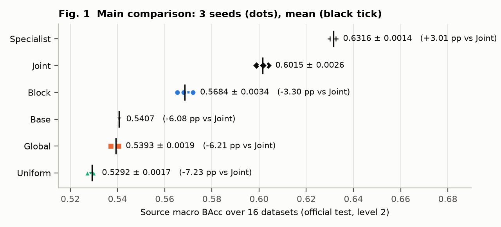

**A.2 Paired comparisons** (official L2, pp). "Datasets improved" counts the datasets on which the first model is higher.

| Comparison | seed 0 | seed 1 | seed 2 | Mean ± std | Datasets improved (per seed) | Datasets improved (seed mean) |
|---|---:|---:|---:|---:|---:|---:|
| Block − Global | +2.76 | +2.82 | +3.15 | +2.91 ± 0.21 | 13/10/13 of 16 | 13 of 16 |
| Global − Uniform | +1.00 | +0.72 | +1.33 | +1.02 ± 0.31 | 9/7/10 of 16 | 9 of 16 |
| Uniform − Base | -1.03 | -1.08 | -1.35 | -1.15 ± 0.17 | 11/10/9 of 16 | 9 of 16 |
| Global − Base | -0.03 | -0.36 | -0.02 | -0.14 ± 0.19 | 9/10/9 of 16 | 10 of 16 |
| Block − Base | +2.73 | +2.46 | +3.13 | +2.77 ± 0.34 | 14/13/14 of 16 | 14 of 16 |
| Block − Joint | -3.59 | -3.35 | -2.97 | -3.30 ± 0.31 | 3/2/4 of 16 | 3 of 16 |
| Joint − Base | +6.32 | +5.81 | +6.10 | +6.08 ± 0.26 | 14/14/13 of 16 | 14 of 16 |
| Specialist − Joint | +2.61 | +3.33 | +3.09 | +3.01 ± 0.37 | 12/14/15 of 16 | 15 of 16 |
| Specialist − Block | +6.20 | +6.68 | +6.06 | +6.31 ± 0.33 | 14/16/15 of 16 | 16 of 16 |

Observations:
- **Every comparison has the same sign in all three seeds.** Global − Base is negative in all three as well, but only −0.03 / −0.36 / −0.02 pp, which is a tie.
- **Uniform is above Base on 9–11 datasets per seed, yet it is 1.15 pp below Base on the macro.** A few large losses drive it (Uniform − Base):
  - ADHD −16.44 pp;
  - FACED −12.32 pp;
  - Workload −10.46 pp;
  - Shin2017A −5.47 pp.
- **Recovery of Joint's gain over Base**, (M − Base) / (Joint − Base), averaged over seeds:

  | Model | Recovery |
  |---|---:|
  | Block | 46 % |
  | Global | −2 % |
  | Uniform | −19 % |
  | Specialist | 150 % |

**A.3 All instruction levels (official)** (Fig. 3):

| Model | Level 0 (Default) | Level 1 (Task) | Level 2 (Task+Target, main) | Δ vs Joint, L0 (pp) | Δ vs Joint, L1 (pp) | Δ vs Joint, L2 (pp) |
|---|---:|---:|---:|---:|---:|---:|
| Base | 0.5058 ± 0.0000 | 0.5327 ± 0.0000 | 0.5407 ± 0.0000 | -4.87 ± 0.19 | -5.09 ± 0.31 | -6.08 ± 0.26 |
| Joint | 0.5545 ± 0.0019 | 0.5836 ± 0.0031 | 0.6015 ± 0.0026 | +0.00 ± 0.00 | +0.00 ± 0.00 | +0.00 ± 0.00 |
| Uniform | 0.5172 ± 0.0025 | 0.5251 ± 0.0025 | 0.5292 ± 0.0017 | -3.73 ± 0.35 | -5.85 ± 0.50 | -7.23 ± 0.30 |
| Global | 0.5260 ± 0.0013 | 0.5331 ± 0.0017 | 0.5393 ± 0.0019 | -2.85 ± 0.20 | -5.05 ± 0.14 | -6.21 ± 0.12 |
| Block | 0.5510 ± 0.0045 | 0.5651 ± 0.0027 | 0.5684 ± 0.0034 | -0.35 ± 0.41 | -1.85 ± 0.23 | -3.30 ± 0.31 |
| Specialist | 0.6198 ± 0.0015 | 0.6269 ± 0.0015 | 0.6316 ± 0.0014 | +6.53 ± 0.20 | +4.33 ± 0.30 | +3.01 ± 0.37 |

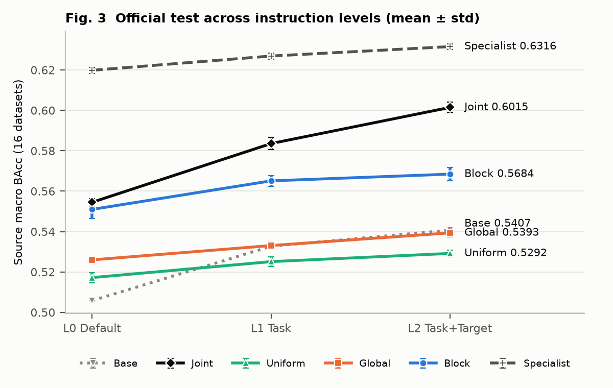

- **The order of the merges is the same at all levels:** Block > Global > Uniform.
- **Base is the exception.** It moves from last place at level 0 (0.5058) to above Global at level 2. Base gains +3.49 pp from level 0 to 2.
- **Joint benefits most from the richer instruction** (+4.70 pp). Block gains +1.75, Global +1.34, Uniform +1.20 and Specialist +1.17.
- **So Block's gap to Joint is small at level 0 and opens up as the instruction adds label information.** Block is −0.35 ± 0.41 pp at level 0, i.e. tied with Joint.

**A.4 Supplementary protocol** (`eval_poc.py`), source macro over 16 datasets:

| Model | BAcc | Kappa | AUROC | wF1 | CE | Δ BAcc vs Joint (pp) |
|---|---:|---:|---:|---:|---:|---:|
| Base | 0.5384 ± 0.0000 | 0.2778 ± 0.0000 | 0.6973 ± 0.0000 | 0.5268 ± 0.0000 | 1.0345 ± 0.0000 | -6.37 ± 0.26 |
| Joint | 0.6022 ± 0.0026 | 0.3789 ± 0.0038 | 0.7469 ± 0.0018 | 0.6118 ± 0.0022 | 0.9673 ± 0.0015 | +0.00 ± 0.00 |
| Uniform | 0.5294 ± 0.0025 | 0.2595 ± 0.0041 | 0.6925 ± 0.0012 | 0.5199 ± 0.0020 | 1.0323 ± 0.0018 | -7.28 ± 0.35 |
| Global | 0.5397 ± 0.0026 | 0.2765 ± 0.0054 | 0.7024 ± 0.0015 | 0.5351 ± 0.0034 | 1.0256 ± 0.0021 | -6.25 ± 0.06 |
| Block | 0.5677 ± 0.0025 | 0.3244 ± 0.0029 | 0.7242 ± 0.0013 | 0.5764 ± 0.0025 | 0.9943 ± 0.0015 | -3.45 ± 0.27 |
| Specialist | 0.6314 ± 0.0016 | 0.4288 ± 0.0031 | 0.7697 ± 0.0008 | 0.6397 ± 0.0021 | 0.9438 ± 0.0030 | +2.92 ± 0.35 |

This agrees with the official test: Block −3.45 ± 0.27 pp vs Joint, against −3.30 ± 0.31 pp.
- Specialist > Joint > Block holds on every metric.
- Base, Global and Uniform are within about 1 pp of each other, and their order depends on the metric. For example, Global is above Base on supplementary BAcc, AUROC and wF1, and Base has the worst CE.

**A.5 External MI_Weibo2014** (supplementary protocol, 10 subjects):

| Model | Weibo BAcc | seed 0 / 1 / 2 | Kappa | AUROC | Δ BAcc vs Joint (pp) |
|---|---:|---:|---:|---:|---:|
| Base | 0.6228 ± 0.0000 | 0.6228 / 0.6228 / 0.6228 | 0.2456 ± 0.0000 | 0.6971 ± 0.0000 | -0.19 ± 0.89 |
| Joint | 0.6247 ± 0.0089 | 0.6234 / 0.6165 / 0.6342 | 0.2494 ± 0.0179 | 0.6918 ± 0.0095 | +0.00 ± 0.00 |
| Uniform | 0.6068 ± 0.0078 | 0.6133 / 0.6089 / 0.5981 | 0.2135 ± 0.0156 | 0.6854 ± 0.0018 | -1.79 ± 1.58 |
| Global | 0.6057 ± 0.0128 | 0.6082 / 0.5918 / 0.6171 | 0.2114 ± 0.0257 | 0.6903 ± 0.0062 | -1.90 ± 0.50 |
| Block | 0.6205 ± 0.0057 | 0.6209 / 0.6146 / 0.6259 | 0.2409 ± 0.0114 | 0.6849 ± 0.0101 | -0.42 ± 0.35 |

- Block is −0.42 ± 0.35 pp vs Joint, while Global and Uniform are ≈ −1.8 pp.
- Base (0.6228) is within noise of Joint and Block, and it has the highest AUROC.
- Fine-tuning on 8 MI sources does not transfer clearly to this external MI dataset.

### B. Per-dataset behaviour

**B.1 Official test BAcc, level 2** (mean ± std over 3 seeds; Base has no variance):

| Dataset | Classes | Base | Joint | Uniform | Global | Block | Specialist |
|---|---:|---:|---:|---:|---:|---:|---:|
| MI_OpenBMI | 2 | 0.7354 | 0.7650 ± 0.0021 | 0.7349 ± 0.0084 | 0.7251 ± 0.0067 | 0.7385 ± 0.0035 | 0.8046 ± 0.0050 |
| MI_BCIC_IV2a | 4 | 0.4462 | 0.6178 ± 0.0320 | 0.5168 ± 0.0041 | 0.4783 ± 0.0048 | 0.6091 ± 0.0081 | 0.6551 ± 0.0005 |
| MI_ShanghaiU | 2 | 0.5357 | 0.5722 ± 0.0058 | 0.5890 ± 0.0040 | 0.5847 ± 0.0074 | 0.5727 ± 0.0062 | 0.5958 ± 0.0178 |
| MI_BCIC_Upperlimb | 3 | 0.4083 | 0.4650 ± 0.0242 | 0.4411 ± 0.0034 | 0.4319 ± 0.0133 | 0.4444 ± 0.0120 | 0.4664 ± 0.0168 |
| MI_HighGamma | 2 | 0.6020 | 0.7134 ± 0.0224 | 0.6310 ± 0.0233 | 0.5740 ± 0.0135 | 0.6317 ± 0.0242 | 0.8085 ± 0.0025 |
| MI_Cho2017 | 2 | 0.7139 | 0.7844 ± 0.0031 | 0.7317 ± 0.0128 | 0.7417 ± 0.0089 | 0.7500 ± 0.0053 | 0.7974 ± 0.0056 |
| MI_Shin2017A | 2 | 0.7056 | 0.7130 ± 0.0297 | 0.6509 ± 0.0097 | 0.7102 ± 0.0058 | 0.7306 ± 0.0056 | 0.7444 ± 0.0217 |
| MI_PhysioNet | 2 | 0.6878 | 0.7336 ± 0.0041 | 0.6702 ± 0.0057 | 0.6374 ± 0.0071 | 0.7041 ± 0.0021 | 0.7548 ± 0.0027 |
| EMO_FACED | 9 | 0.4042 | 0.3916 ± 0.0115 | 0.2810 ± 0.0011 | 0.2363 ± 0.0191 | 0.3304 ± 0.0082 | 0.4067 ± 0.0044 |
| EMO_SEED_3_seg4 | 3 | 0.5890 | 0.6873 ± 0.0050 | 0.6070 ± 0.0016 | 0.6270 ± 0.0093 | 0.6570 ± 0.0109 | 0.6685 ± 0.0163 |
| EMO_SEED_4_seg4 | 4 | 0.3757 | 0.4432 ± 0.0006 | 0.4041 ± 0.0055 | 0.4486 ± 0.0047 | 0.4185 ± 0.0064 | 0.4583 ± 0.0097 |
| EMO_SEED_5_seg4 | 5 | 0.3031 | 0.3817 ± 0.0032 | 0.3163 ± 0.0033 | 0.3490 ± 0.0099 | 0.3514 ± 0.0111 | 0.3831 ± 0.0091 |
| EMO_SEED_7_seg4 | 7 | 0.2524 | 0.3215 ± 0.0021 | 0.2779 ± 0.0030 | 0.3025 ± 0.0072 | 0.3055 ± 0.0090 | 0.3290 ± 0.0023 |
| SSVEP_OpenBMI | 4 | 0.5615 | 0.7550 ± 0.0053 | 0.5539 ± 0.0116 | 0.5710 ± 0.0228 | 0.5907 ± 0.0031 | 0.8925 ± 0.0042 |
| Workload | 2 | 0.6444 | 0.5667 ± 0.0247 | 0.5398 ± 0.0305 | 0.5796 ± 0.0161 | 0.5667 ± 0.0200 | 0.6232 ± 0.0070 |
| ADHD_AliMotie | 2 | 0.6853 | 0.7118 ± 0.0330 | 0.5209 ± 0.0048 | 0.6317 ± 0.0268 | 0.6933 ± 0.0271 | 0.7169 ± 0.0311 |
| **Source macro** |  | **0.5407** | **0.6015** | **0.5292** | **0.5393** | **0.5684** | **0.6316** |

**B.2 Δ vs Joint per dataset (pp, paired by seed)** (Fig. 2):

| Dataset | Base | Uniform | Global | Block | Specialist |
|---|---:|---:|---:|---:|---:|
| MI_OpenBMI | -2.96 ± 0.21 | -3.01 ± 0.68 | -3.99 ± 0.73 | -2.65 ± 0.39 | +3.96 ± 0.66 |
| MI_BCIC_IV2a | -17.16 ± 3.20 | -10.10 ± 2.83 | -13.95 ± 2.78 | -0.87 ± 3.46 | +3.73 ± 3.22 |
| MI_ShanghaiU | -3.65 ± 0.58 | +1.68 ± 0.41 | +1.26 ± 1.28 | +0.05 ± 1.19 | +2.36 ± 1.80 |
| MI_BCIC_Upperlimb | -5.67 ± 2.42 | -2.39 ± 2.22 | -3.31 ± 3.06 | -2.06 ± 2.52 | +0.14 ± 3.77 |
| MI_HighGamma | -11.14 ± 2.24 | -8.23 ± 2.50 | -13.94 ± 3.23 | -8.17 ± 4.66 | +9.51 ± 2.14 |
| MI_Cho2017 | -7.05 ± 0.31 | -5.28 ± 1.11 | -4.28 ± 1.10 | -3.44 ± 0.58 | +1.30 ± 0.70 |
| MI_Shin2017A | -0.74 ± 2.97 | -6.20 ± 3.94 | -0.28 ± 2.78 | +1.76 ± 2.42 | +3.15 ± 4.09 |
| MI_PhysioNet | -4.58 ± 0.41 | -6.34 ± 0.28 | -9.62 ± 0.51 | -2.95 ± 0.54 | +2.11 ± 0.66 |
| EMO_FACED | +1.26 ± 1.15 | -11.05 ± 1.09 | -15.53 ± 2.02 | -6.11 ± 0.72 | +1.51 ± 1.14 |
| EMO_SEED_3_seg4 | -9.83 ± 0.50 | -8.02 ± 0.34 | -6.02 ± 1.07 | -3.03 ± 0.78 | -1.87 ± 1.52 |
| EMO_SEED_4_seg4 | -6.75 ± 0.06 | -3.91 ± 0.49 | +0.55 ± 0.41 | -2.46 ± 0.59 | +1.51 ± 1.02 |
| EMO_SEED_5_seg4 | -7.86 ± 0.32 | -6.54 ± 0.25 | -3.28 ± 0.68 | -3.03 ± 0.81 | +0.14 ± 0.60 |
| EMO_SEED_7_seg4 | -6.91 ± 0.21 | -4.36 ± 0.49 | -1.89 ± 0.93 | -1.60 ± 1.04 | +0.75 ± 0.30 |
| SSVEP_OpenBMI | -19.35 ± 0.53 | -20.11 ± 1.05 | -18.40 ± 1.99 | -16.43 ± 0.56 | +13.75 ± 0.95 |
| Workload | +7.77 ± 2.47 | -2.68 ± 4.78 | +1.30 ± 3.31 | +0.00 ± 1.27 | +5.65 ± 2.64 |
| ADHD_AliMotie | -2.65 ± 3.30 | -19.09 ± 2.96 | -8.02 ± 3.28 | -1.86 ± 3.93 | +0.51 ± 0.54 |
| **Source macro** | **-6.08 ± 0.26** | **-7.23 ± 0.30** | **-6.21 ± 0.12** | **-3.30 ± 0.31** | **+3.01 ± 0.37** |

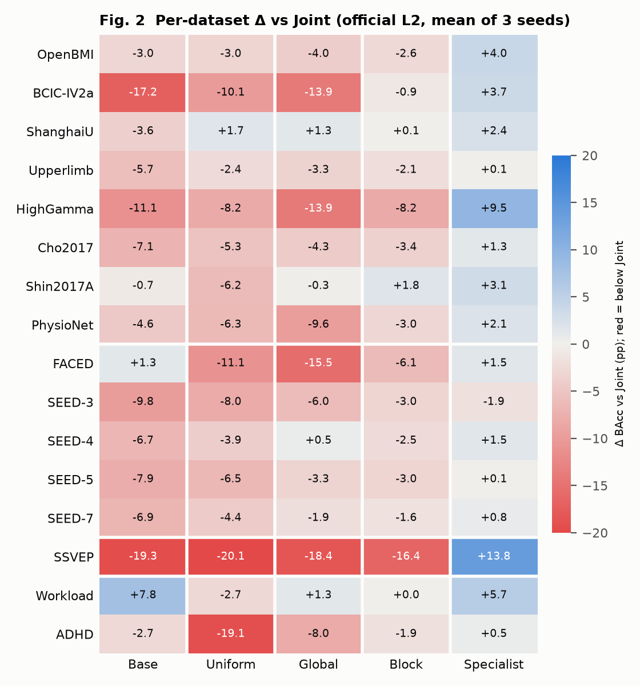

**B.3 Counts per seed:**

| Model | Datasets above Joint (seed 0/1/2) | Datasets below Base (seed 0/1/2) | Below Base on the seed mean |
|---|---:|---:|---|
| Base | 2/2/3 | – | – |
| Uniform | 2/1/1 | 5/6/7 | OpenBMI, Shin2017A, PhysioNet, FACED, SSVEP, Workload, ADHD |
| Global | 3/2/3 | 7/6/6 | OpenBMI, HighGamma, PhysioNet, FACED, Workload, ADHD |
| Block | 3/2/4 | 2/3/2 | FACED, Workload |
| Specialist | 12/14/15 | 1/1/2 | Workload |

- **Joint itself is below Base on two datasets:** FACED (−1.26 pp) and Workload (−7.77 pp).
- **On Workload even the specialist is below Base** (0.6232 vs 0.6444). Workload has only 240 test samples.
- **These are the only two datasets where Block is below Base on the seed mean.**

**B.4 Where the gap comes from.**
- The macro gap is the mean of the per-dataset gaps, so each dataset contributes (Joint_d − Block_d) / 16 (Fig. 7).

| Dataset (sorted by Block gap) | Joint − Block (pp) | Contribution to macro gap (pp) | Share of Block macro gap | Cumulative share | Share of Global gap | Share of Uniform gap |
|---|---:|---:|---:|---:|---:|---:|
| SSVEP_OpenBMI | +16.43 ± 0.56 | +1.03 | +31.1 % | 31.1 % | +18.5 % | +17.4 % |
| MI_HighGamma | +8.17 ± 4.66 | +0.51 | +15.5 % | 46.5 % | +14.0 % | +7.1 % |
| EMO_FACED | +6.11 ± 0.72 | +0.38 | +11.6 % | 58.1 % | +15.6 % | +9.6 % |
| MI_Cho2017 | +3.44 ± 0.58 | +0.22 | +6.5 % | 64.6 % | +4.3 % | +4.6 % |
| EMO_SEED_5_seg4 | +3.03 ± 0.81 | +0.19 | +5.7 % | 70.4 % | +3.3 % | +5.7 % |
| EMO_SEED_3_seg4 | +3.03 ± 0.78 | +0.19 | +5.7 % | 76.1 % | +6.1 % | +6.9 % |
| MI_PhysioNet | +2.95 ± 0.54 | +0.18 | +5.6 % | 81.7 % | +9.7 % | +5.5 % |
| MI_OpenBMI | +2.65 ± 0.39 | +0.17 | +5.0 % | 86.7 % | +4.0 % | +2.6 % |
| EMO_SEED_4_seg4 | +2.46 ± 0.59 | +0.15 | +4.7 % | 91.3 % | -0.5 % | +3.4 % |
| MI_BCIC_Upperlimb | +2.06 ± 2.52 | +0.13 | +3.9 % | 95.2 % | +3.3 % | +2.1 % |
| ADHD_AliMotie | +1.86 ± 3.93 | +0.12 | +3.5 % | 98.7 % | +8.1 % | +16.5 % |
| EMO_SEED_7_seg4 | +1.60 ± 1.04 | +0.10 | +3.0 % | 101.8 % | +1.9 % | +3.8 % |
| MI_BCIC_IV2a | +0.87 ± 3.46 | +0.05 | +1.6 % | 103.4 % | +14.0 % | +8.7 % |
| Workload | +0.00 ± 1.27 | +0.00 | +0.0 % | 103.4 % | -1.3 % | +2.3 % |
| MI_ShanghaiU | -0.05 ± 1.19 | +0.00 | -0.1 % | 103.3 % | -1.3 % | -1.5 % |
| MI_Shin2017A | -1.76 ± 2.42 | -0.11 | -3.3 % | 100.0 % | +0.3 % | +5.4 % |

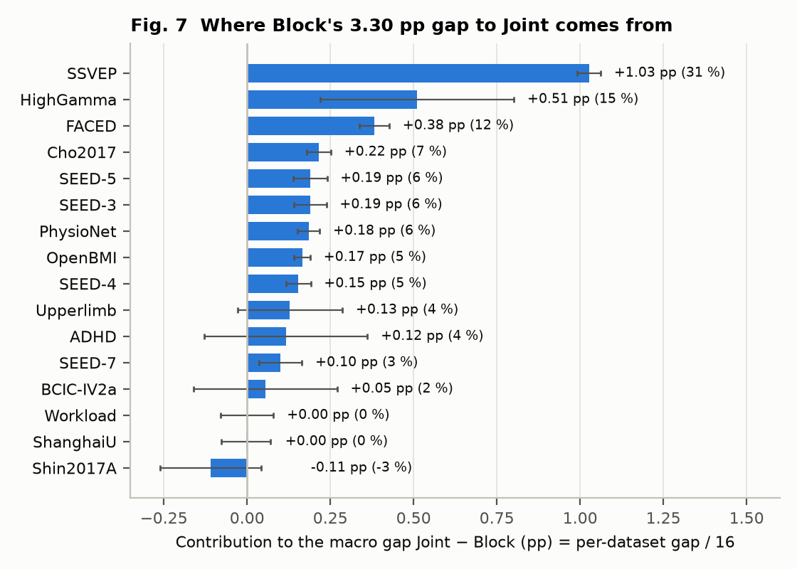

- **SSVEP alone is 31 % of Block's gap. With HighGamma and FACED, the three datasets make up 58 %.** Without these three, Block's gap to Joint would be 1.38 pp × 16/13 ≈ 1.7 pp on the remaining 13.
- **SSVEP is the worst dataset for every merge** (−16 to −20 pp vs Joint). Joint keeps 0.7550, and the SSVEP expert reaches 0.8925.
- **HighGamma has a large seed std** (Block −8.17 ± 4.66 pp).
- **FACED** (9 classes, chance 0.11) is the only dataset where all three merges are far below Base: Global 0.2363, Uniform 0.2810 and Block 0.3304 against Base 0.4042 (−16.8, −12.3 and −7.4 pp).
- **On BCIC-IV2a Block nearly matches Joint** (0.6091 vs 0.6178, −0.87 ± 3.46 pp), while Global stays near Base (0.4783). Global gives the IV2a expert a negative weight in all three seeds (Section E.1).

**B.5 Retention of the specialist's gain**, (M − Base) / (Specialist − Base), shown only for the 12 datasets where the specialist gains ≥ 5 pp over Base. Shin2017A, FACED, Workload and ADHD are excluded because the ratio is unstable there.

| Dataset | Specialist − Base (pp) | Joint | Uniform | Global | Block |
|---|---:|---:|---:|---:|---:|
| MI_OpenBMI | +6.92 | 43 % | -1 % | -15 % | 5 % |
| MI_BCIC_IV2a | +20.89 | 82 % | 34 % | 15 % | 78 % |
| MI_ShanghaiU | +6.01 | 61 % | 89 % | 82 % | 62 % |
| MI_BCIC_Upperlimb | +5.81 | 98 % | 57 % | 41 % | 62 % |
| MI_HighGamma | +20.65 | 54 % | 14 % | -14 % | 14 % |
| MI_Cho2017 | +8.35 | 84 % | 21 % | 33 % | 43 % |
| MI_PhysioNet | +6.70 | 68 % | -26 % | -75 % | 24 % |
| EMO_SEED_3_seg4 | +7.95 | 124 % | 23 % | 48 % | 85 % |
| EMO_SEED_4_seg4 | +8.26 | 82 % | 34 % | 88 % | 52 % |
| EMO_SEED_5_seg4 | +8.00 | 98 % | 17 % | 57 % | 60 % |
| EMO_SEED_7_seg4 | +7.66 | 90 % | 33 % | 65 % | 69 % |
| SSVEP_OpenBMI | +33.10 | 58 % | -2 % | 3 % | 9 % |

- **Block keeps ≥ 60 % of the expert's gain on:**
  - IV2a, ShanghaiU and Upperlimb;
  - SEED-3, SEED-5 and SEED-7.
- **Block keeps ≤ 25 % on:**
  - SSVEP (9 %) and HighGamma (14 %);
  - OpenBMI (5 %) and PhysioNet (24 %).
- OpenBMI and PhysioNet are the two largest MI datasets. Their Block weights are small (mean α 0.017 and 0.020; Section E.1).
- **Joint's lowest retentions are on the same datasets:** OpenBMI 43 %, HighGamma 54 % and SSVEP 58 %. Joint exceeds the specialist on SEED-3 (124 %).

**B.6 Task-family summary** (official L2, macro within each family, seed mean):

| Family | Base | Joint | Uniform | Global | Block | Specialist | Block − Joint (pp) |
|---|---:|---:|---:|---:|---:|---:|---:|
| MI (8) | 0.6044 | 0.6705 | 0.6207 | 0.6104 | 0.6476 | 0.7034 | -2.29 |
| Emotion (5) | 0.3849 | 0.4450 | 0.3773 | 0.3927 | 0.4126 | 0.4491 | -3.25 |
| SSVEP (1) | 0.5615 | 0.7550 | 0.5539 | 0.5710 | 0.5907 | 0.8925 | -16.43 |
| Workload + ADHD (2) | 0.6648 | 0.6392 | 0.5304 | 0.6057 | 0.6300 | 0.6700 | -0.93 |

### C. Seed stability

- **The macro std is small:** 0.0014–0.0034 for every trained model. The ranking of the six models is identical in all seeds.
- **Paired differences have smaller std than the raw values,** for example Block − Joint ± 0.31 pp and Block − Global ± 0.21 pp. Every reported comparison has the same sign in all three seeds; Global − Base is consistently negative but negligible.
- **Per-dataset std is large on the small test sets,** for example Workload (240 test samples), Shin2017A (360) and ADHD (599). It is also large on BCIC-IV2a and HighGamma for Joint (3.2 and 2.2 pp). On these datasets the per-dataset differences in B.2 are not resolved with three seeds.

### D. Optimisation and validation

| Model | Best val macro BAcc | Selected step | Official test (L2) | Supplementary test |
|---|---:|---:|---:|---:|
| Joint | 0.6779 ± 0.0025 | 3000 / 2700 / 2800 of 3000 rounds | 0.6015 ± 0.0026 | 0.6022 ± 0.0026 |
| Uniform | 0.5816 ± 0.0042 | 0 (no optimisation) | 0.5292 ± 0.0017 | 0.5294 ± 0.0025 |
| Global | 0.5952 ± 0.0012 | 960 / 1280 / 320 of 1600 | 0.5393 ± 0.0019 | 0.5397 ± 0.0026 |
| Block | 0.6262 ± 0.0003 | 1600 / 1280 / 1120 of 1600 | 0.5684 ± 0.0034 | 0.5677 ± 0.0025 |
| Specialist | 0.7191 ± 0.0006 | – | 0.6316 ± 0.0014 | 0.6314 ± 0.0016 |

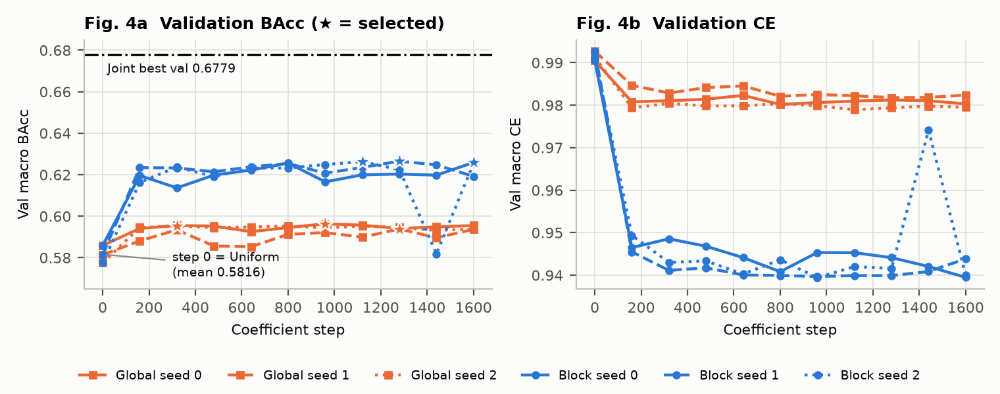

**Validation level vs test.**
- Validation BAcc is 5–9 pp above test for every model. For example, Joint is 0.6779 on validation against 0.6015 on test.
- **The validation gap Joint − Block (4.9–5.5 pp per seed) is larger than the test gap (3.30 pp).** Validation is not a calibrated estimate of test here; it was used only for selection.

**The merges plateau early.**
- At the first validation (step 160, i.e. 10 batches per dataset), Block has already reached 84 / 93 / 80 % of its final validation gain over Uniform (seed 0 / 1 / 2); Global has reached 78 / 54 / 95 %.
- **Block:** after step 160, validation BAcc moves in a band of 0.7–1.2 pp, apart from the seed-2 drop below. Seed 0's selected step 1600 beats step 800 by 0.03 pp. The final gains over Uniform are +4.0 / +4.5 / +4.9 pp.
- **Global** gains +1.0 / +1.3 / +1.8 pp over Uniform.
- **One instability event:** at step 1440, Block seed 2 fell to val BAcc 0.582, the Uniform level, with CE 0.974. It recovered to 0.626 at step 1600. This seed's selected checkpoint is from step 1120. The cause was not investigated (Adam with lr 1e-2 on 528 unconstrained coefficients).

**Training of experts and Joint.**
- Joint is selected at round 3000 / 2700 / 2800 of 3000, close to the end of the budget.
- The experts' selected rounds vary a lot:

| Dataset | Selected round (seed 0/1/2, of 3000) |
|---|---:|
| MI_OpenBMI | 2900 / 2500 / 2600 |
| MI_BCIC_IV2a | 2100 / 2700 / 2600 |
| MI_ShanghaiU | 2800 / 2700 / 3000 |
| MI_BCIC_Upperlimb | 500 / 500 / 300 |
| MI_HighGamma | 2500 / 2700 / 2300 |
| MI_Cho2017 | 2800 / 2900 / 2800 |
| MI_Shin2017A | 700 / 2300 / 500 |
| MI_PhysioNet | 2800 / 2600 / 2700 |
| EMO_FACED | 2700 / 1700 / 2900 |
| EMO_SEED_3_seg4 | 500 / 600 / 800 |
| EMO_SEED_4_seg4 | 1700 / 1500 / 1200 |
| EMO_SEED_5_seg4 | 700 / 1400 / 700 |
| EMO_SEED_7_seg4 | 1700 / 900 / 2400 |
| SSVEP_OpenBMI | 3000 / 3000 / 3000 |
| Workload | 2600 / 2600 / 2600 |
| ADHD_AliMotie | 3000 / 300 / 400 |

- The SSVEP expert is selected at the last round in all seeds and may still be improving. Upperlimb and SEED-3 peak early (300–800 rounds).

### E. Learned coefficients

**E.1 Global coefficients** (16 per seed), with each expert's mean Block coefficient and its task-vector norm:

| Expert | α seed 0 | α seed 1 | α seed 2 | Mean ± std | Block: mean α over 33 groups (seed mean) | Task-vector L2 (seed mean) |
|---|---:|---:|---:|---:|---:|---:|
| MI_OpenBMI | +0.154 | +0.108 | +0.064 | +0.108 ± 0.045 | +0.017 | 19.4 |
| MI_BCIC_IV2a | -0.086 | -0.058 | -0.054 | -0.066 ± 0.017 | +0.085 | 24.6 |
| MI_ShanghaiU | +0.027 | +0.045 | -0.038 | +0.011 ± 0.044 | +0.045 | 28.3 |
| MI_BCIC_Upperlimb | +0.107 | +0.034 | +0.172 | +0.104 ± 0.069 | +0.188 | 13.3 |
| MI_HighGamma | +0.027 | +0.026 | +0.031 | +0.028 ± 0.003 | +0.022 | 20.8 |
| MI_Cho2017 | +0.037 | +0.029 | +0.044 | +0.037 ± 0.008 | +0.005 | 24.3 |
| MI_Shin2017A | +0.067 | +0.041 | +0.179 | +0.096 ± 0.073 | +0.083 | 15.5 |
| MI_PhysioNet | +0.015 | +0.033 | +0.019 | +0.023 ± 0.009 | +0.020 | 21.9 |
| EMO_FACED | +0.123 | +0.131 | +0.064 | +0.106 ± 0.037 | +0.219 | 18.4 |
| EMO_SEED_3_seg4 | +0.144 | +0.107 | +0.035 | +0.095 ± 0.055 | +0.229 | 13.2 |
| EMO_SEED_4_seg4 | +0.219 | +0.155 | +0.195 | +0.190 ± 0.033 | +0.159 | 16.4 |
| EMO_SEED_5_seg4 | +0.162 | +0.136 | +0.166 | +0.155 ± 0.016 | +0.142 | 14.1 |
| EMO_SEED_7_seg4 | +0.065 | +0.119 | +0.211 | +0.132 ± 0.074 | +0.230 | 16.3 |
| SSVEP_OpenBMI | +0.095 | +0.132 | +0.118 | +0.115 ± 0.019 | +0.106 | 21.4 |
| Workload | +0.104 | +0.148 | +0.045 | +0.099 ± 0.052 | +0.042 | 17.3 |
| ADHD_AliMotie | +0.111 | +0.115 | +0.193 | +0.139 ± 0.046 | +0.061 | 8.3 |
| **Σ over experts** | **1.370** | **1.301** | **1.444** | **1.372 ± 0.071** | **1.653** (mean of per-group sums) |  |

- **Global's Σα is 1.37 ± 0.07, not 1.** The optimiser scales the summed update up by about 37 %.
- **The largest Global weights go to the emotion and small datasets:** SEED-4 0.190, SEED-5 0.155, ADHD 0.139, SEED-7 0.132.
- **The BCIC-IV2a expert gets a negative weight in all three seeds** (−0.086 / −0.058 / −0.054).
- **Global weights correlate across seeds** at r = 0.53–0.85.
- **Experts with larger task vectors get smaller coefficients.** The seed-mean Spearman ρ between coefficient and ‖δ_k‖ is −0.62 for Global and −0.54 for the Block mean α, over n = 16 experts. The norms range from 8.3 (ADHD) to 28.3 (ShanghaiU).
- **An expert's mean Block α only weakly predicts Block's gain over Base on its own dataset** (ρ = 0.47, n = 16).

**E.2 Block coefficients by region** (528 per seed; Fig. 5):

| Region | Groups | Mean Σ_k α (± seed std) | Range of Σ_k α (all groups, all seeds) | Negative α | max \|α\| |
|---|---:|---:|---:|---:|---:|
| tower.input | 1 | 0.07 ± 0.06 | 0.00 … 0.11 | 44 % | 0.14 |
| tower.mask.outer | 1 | 0.80 ± 0.45 | 0.28 … 1.11 | 42 % | 0.44 |
| mask layers 00–11 | 12 | 1.43 ± 0.27 | -1.51 … 5.36 | 40 % | 1.29 |
| tower.next.outer | 1 | 1.32 ± 0.27 | 1.02 … 1.56 | 42 % | 0.66 |
| next layers 00–11 | 12 | 1.81 ± 0.16 | -2.64 … 6.14 | 40 % | 1.16 |
| qformer.condition | 1 | -2.94 ± 0.92 | -3.84 … -2.00 | 60 % | 1.45 |
| Q-Former layers 00–03 | 4 | 2.30 ± 0.15 | 0.66 … 4.93 | 24 % | 0.69 |
| qformer.output | 1 | 7.17 ± 0.33 | 6.79 … 7.42 | 8 % | 1.46 |

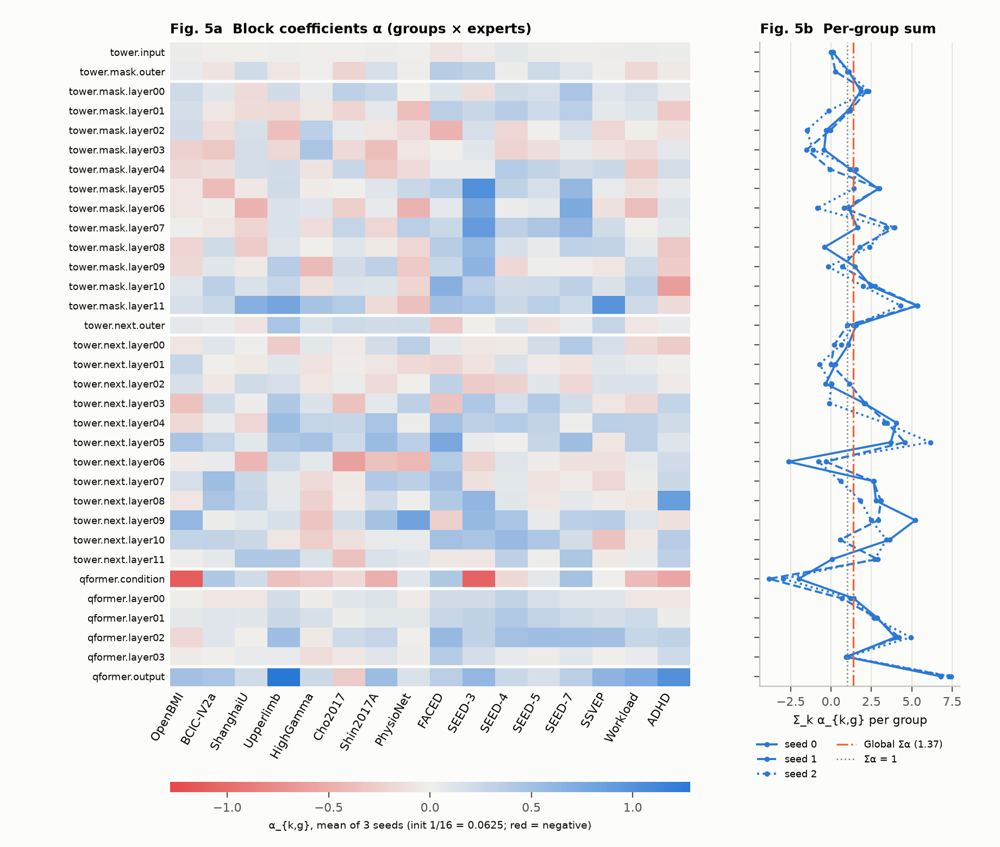

| Group | Σ_k α (seed 0/1/2) | Largest α (seed mean) | Most negative α (any seed) |
|---|---:|---|---:|
| qformer.output | 6.79 / 7.29 / 7.42 | Upperlimb +1.28, ADHD +1.02, Workload +0.75 | -0.45 |
| qformer.condition | -2.00 / -3.84 / -2.97 | SEED-7 +0.48, BCIC-IV2a +0.42, FACED +0.42 | -1.45 |
| tower.mask.layer11 | 5.33 / 5.36 / 4.32 | SSVEP +0.97, Upperlimb +0.79, ShanghaiU +0.67 | -0.67 |
| tower.input | 0.11 / 0.00 / 0.10 | SEED-4 +0.08, Workload +0.04, ADHD +0.03 | -0.13 |
| tower.next.outer | 1.56 / 1.02 / 1.38 | Upperlimb +0.45, SSVEP +0.28, Cho2017 +0.23 | -0.49 |

- **All Block coefficients lie in [−1.45, +1.46], and 38 % are negative.** The mean per-group sum is 1.65.
- **The per-group sums have a reproducible profile:**
  - `qformer.output` has the largest Σα in every seed (6.79 / 7.29 / 7.42). This group moves about 7× as far as in Uniform, where Σα = 1.
  - `tower.mask.layer11` is in the top four in every seed (5.33 / 5.36 / 4.32).
  - `qformer.condition` and `tower.mask.layer03` are in the bottom three in every seed. `qformer.condition` is negative in all seeds (−2.00 / −3.84 / −2.97).
  - The EEG input layer stays at Base: Σα 0.00–0.11, max \|α\| 0.14.
- **Cross-seed consistency:**

  | What is compared | Pearson r between seeds |
  |---|---:|
  | Σα profile over the 33 groups | 0.79–0.87 |
  | Full 16 × 33 α matrix | 0.39–0.45 |
  | Full α matrix with each group's mean removed | 0.33–0.39 |

  The group's top expert is the same in all three seeds for only 4 of 33 groups: SEED-3 in mask layers 05 and 07, FACED in mask layer 10 and Q-Former layer 03.
- **On the seed-mean matrix, emotion experts are the top expert in 23 of 33 groups:**

  | Expert | Groups |
  |---|---:|
  | FACED | 7 |
  | SEED-3 | 6 |
  | SEED-4 | 6 |
  | SEED-7 | 4 |

  Together with the small task-vector norms of these experts (13–18), this matches the norm correlation in E.1.
- **Interpretation (hypothesis):** how much to move each group along the summed update is identifiable from calibration data, but which expert supplies it is not. That points to per-group scaling as the active ingredient of Block.

### F. K = 5 vs K = 16 on the 5 shared datasets

The 5-dataset 3-seed run `runs/poc3k` (OpenBMI, Cho2017, PhysioNet, SEED-3, SSVEP) uses the same 3,000-step recipe and seeds.
- Its experts are byte-identical to the corresponding poc16 experts (`cmp`, all 15 checkpoints), so Specialist and Base are identical by construction.
- Per-dataset budgets are equal: Joint has 3,000 batches per dataset (15,000 vs 48,000 total steps), and merges have 100 calibration batches per dataset (500 vs 1,600 steps).
- What changes: Joint trains on 11 more datasets, and the merges include 11 more experts.

**F.1 Macro over the 5 shared datasets (official L2)** (Fig. 6):

| Model | K = 5 (runs/poc3k) | K = 16 (runs/poc16) | K16 − K5 (pp, paired by seed) |
|---|---:|---:|---:|
| Base | 0.6575 ± 0.0000 | 0.6575 ± 0.0000 | +0.00 ± 0.00 |
| Joint | 0.7753 ± 0.0042 | 0.7451 ± 0.0020 | -3.03 ± 0.25 |
| Uniform | 0.6872 ± 0.0014 | 0.6595 ± 0.0076 | -2.76 ± 0.71 |
| Global | 0.6962 ± 0.0016 | 0.6604 ± 0.0031 | -3.58 ± 0.27 |
| Block | 0.7102 ± 0.0046 | 0.6881 ± 0.0028 | -2.21 ± 0.73 |
| Specialist | 0.7836 ± 0.0048 | 0.7836 ± 0.0048 | +0.00 ± 0.00 |

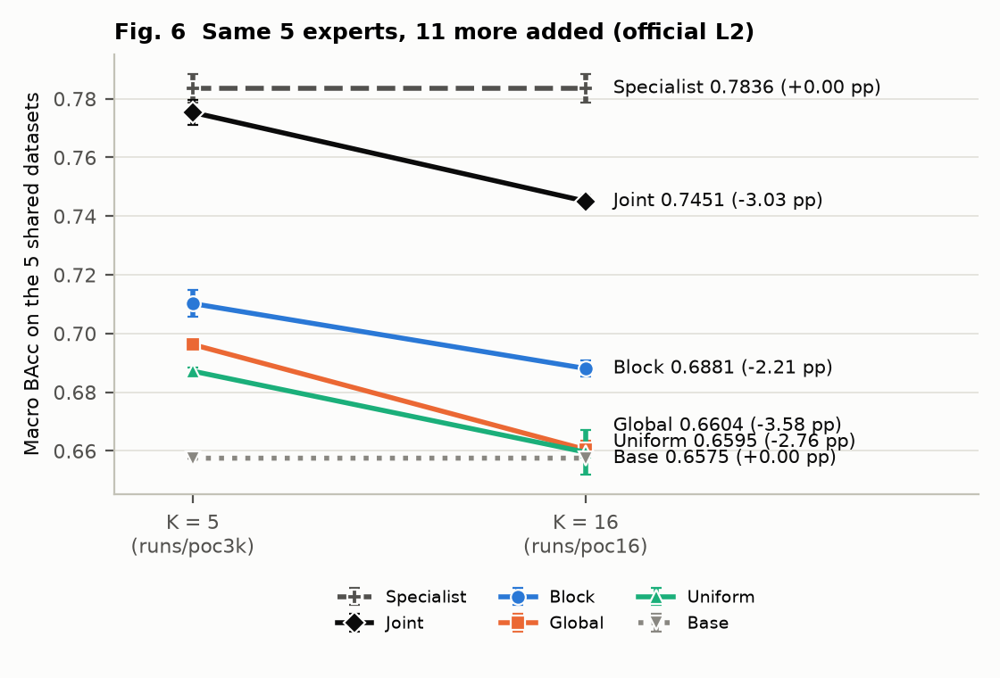

**F.2 Per dataset (seed mean):**

| Dataset | Joint K5 → K16 | Uniform K5 → K16 | Global K5 → K16 | Block K5 → K16 |
|---|---:|---:|---:|---:|
| MI_OpenBMI | 0.7943 → 0.7650 (-2.93) | 0.7612 → 0.7349 (-2.63) | 0.7462 → 0.7251 (-2.11) | 0.7600 → 0.7385 (-2.15) |
| MI_Cho2017 | 0.7902 → 0.7844 (-0.58) | 0.7761 → 0.7317 (-4.45) | 0.7596 → 0.7417 (-1.80) | 0.7546 → 0.7500 (-0.46) |
| MI_PhysioNet | 0.7546 → 0.7336 (-2.10) | 0.6804 → 0.6702 (-1.02) | 0.6582 → 0.6374 (-2.08) | 0.7088 → 0.7041 (-0.47) |
| EMO_SEED_3_seg4 | 0.6832 → 0.6873 (+0.41) | 0.5972 → 0.6070 (+0.98) | 0.6316 → 0.6270 (-0.45) | 0.6469 → 0.6570 (+1.01) |
| SSVEP_OpenBMI | 0.8543 → 0.7550 (-9.93) | 0.6209 → 0.5539 (-6.70) | 0.6855 → 0.5710 (-11.45) | 0.6805 → 0.5907 (-8.98) |

**F.3 Gap to Joint, shared vs added datasets (K = 16, official L2, pp):**

| Model | 5 shared, K = 5 | 5 shared, K = 16 | 11 added, K = 16 | All 16, K = 16 |
|---|---:|---:|---:|---:|
| Base | -11.78 | -8.75 | -4.86 | -6.08 |
| Uniform | -8.82 | -8.55 | -6.62 | -7.23 |
| Global | -7.91 | -8.46 | -5.19 | -6.21 |
| Block | -6.51 | -5.70 | -2.21 | -3.30 |
| Specialist | +0.82 | +3.85 | +2.63 | +3.01 |

**F.4 Observations**
- **Joint and every merge lose on the shared datasets when K grows**: Joint −3.03, Block −2.21, Global −3.58, Uniform −2.76 pp. Most of Joint's loss is SSVEP (−9.93 pp), then OpenBMI (−2.93) and PhysioNet (−2.10).
- **The merge-vs-Joint gap on the 16 sources (−3.30 pp) is smaller than at K = 5 (−6.51 pp), for two reasons:**
  1. Joint also degrades on the shared datasets (gap −6.51 → −5.70).
  2. The 11 added datasets have a smaller gap (−2.21 pp), partly because Joint is weak on Workload and FACED.
- **It is not because merging improved:** Block's own accuracy on the shared datasets dropped.
- **Uniform at K = 16 is essentially Base on the shared datasets** (0.6595 vs 0.6575). Each expert enters with weight 1/16. This is consistent with dilution: at K = 5, Uniform was +2.97 pp above Base on the same datasets.

**F.5 Conclusions**

1. **Does merging approach Joint at K = 16?**
   - Not yet. Block is −3.30 ± 0.31 pp (official L2) and −3.45 ± 0.27 pp (supplementary). It is below Joint on 12–14 of 16 datasets per seed.
   - Block is within noise of Joint at level 0 (−0.35 ± 0.41 pp) and on ShanghaiU, Shin2017A and Workload.
2. **Is block-wise merging beneficial?**
   - Yes, clearly and consistently: Block − Global = +2.91 ± 0.21 pp (13 / 10 / 13 datasets improved).
   - The gain over Global is much larger than at K = 5, where it was +1.40 pp (0.7102 vs 0.6962, 5-dataset macro).
   - Global and Uniform give no benefit over Base at K = 16.
3. **What is the most likely remaining bottleneck?** (interpretation)
   - SSVEP: one dataset is 31 % of the gap, and no merge keeps more than 9 % of the SSVEP expert's gain.
   - The dilution of 16 task vectors. Uniform ≈ Base, and Block's reproducible ingredient is the per-group scale: Σα up to 7.4, with individual α not identifiable.
   - The large MI datasets (OpenBMI, PhysioNet, HighGamma) get small coefficients and little retention.
4. **What changes with K?**
   - Joint itself degrades with more tasks on the shared datasets (−3.03 pp). Part of the apparent narrowing of the merge gap at K = 16 comes from this, not from the merges.
   - For the paper, the K = 16 comparison against Joint should be reported together with the shared-dataset view (F.1–F.3).
5. **Single next experiment to run (proposal, not done):**
   - **Per-group scale on the uniform task-vector sum:** θ₀ᵍ + λ_g Σ_k δ_kᵍ, with 33 coefficients.
   - Use the same calibration, budget and selection as Block.
   - If it matches Block (0.5684), the expert-specific weights add nothing, which would settle the dilution hypothesis. If it is far below, expert selection matters.
   - A single global λ (one coefficient) is the zero-cost baseline for the same question.

### G. Softmax-constrained merging (convex combination of experts)

**G.0 What was run.** The round-2 softmax merges of `/home/jingzhou/BFM-merge/Model_softmax_merging_POC.md` were first run on the 5-dataset, 1,000-step experts (`runs/poc`, report `runs/poc/Softmax_Merging_Experiment_Report.md`). This round repeats them on each poc16 seed's 16 experts (`runs/poc16/chain_softmax.sh`).
- **Softmax-Global:** θ = Σ_k α_k θ_k with α = softmax(β), β ∈ ℝ¹⁶.
- **Softmax-Block:** θᵍ = Σ_k α_{k,g} θ_kᵍ with α_{·,g} = softmax(β_{·,g}) in each of the 33 groups, β ∈ ℝ^{16×33}.
- **Relation to Global and Block:** this equals θ₀ + Σ_k α_k δ_k with α ≥ 0 and Σ_k α = 1 per group. The merge can only average the experts. It cannot amplify the summed update (Σα > 1) or subtract an expert (α < 0).
- **Start point:** β = 0, so α = 1/16, which is Uniform. The step-0 validation BAcc equals Uniform's to within 0.003 pp; the difference is fp32 rounding of the two compositions.
- **Everything else is identical to the Global / Block merge of the same seed:**
  - the experts (no retraining);
  - the calibration subsets (`calibration_indices.npz` byte-identical to `merge_block`'s, checked with `cmp`);
  - Adam lr 1e-2 on β, 1,600 steps, validation every 160, the same selection rule;
  - no model weight is fine-tuned after merging.
- **Tests:**
  - Official: `c_direct_inference.py` on the 16 sources.
  - Supplementary: `eval_poc.py`, which also re-evaluated Base and Joint. Every re-evaluated metric is identical to the original run.
  - The new per-seed tables reproduce every non-softmax row of the tables used in Sections A–F exactly.

**G.1 Official test, level 2** (Fig. 8):

| Model | Source macro BAcc | seed 0 | seed 1 | seed 2 | Δ vs Joint (pp) | Δ vs Base (pp) | Share of Joint − Base recovered |
|---|---:|---:|---:|---:|---:|---:|---:|
| Specialist (16 experts, reference) | 0.6316 ± 0.0014 | 0.6300 | 0.6321 | 0.6326 | +3.01 ± 0.37 | +9.09 ± 0.14 |  |
| Joint | 0.6015 ± 0.0026 | 0.6039 | 0.5988 | 0.6017 | +0.00 ± 0.00 | +6.08 ± 0.26 |  |
| Block | 0.5684 ± 0.0034 | 0.5680 | 0.5653 | 0.5720 | -3.30 ± 0.31 | +2.77 ± 0.34 | 46 % |
| **Softmax-Block** | 0.5528 ± 0.0011 | 0.5527 | 0.5518 | 0.5539 | -4.87 ± 0.22 | +1.21 ± 0.11 | 20 % |
| **Softmax-Global** | 0.5418 ± 0.0012 | 0.5422 | 0.5405 | 0.5428 | -5.96 ± 0.18 | +0.11 ± 0.12 | 2 % |
| Base | 0.5407 ± 0.0000 | 0.5407 | 0.5407 | 0.5407 | -6.08 ± 0.26 | +0.00 ± 0.00 |  |
| Global | 0.5393 ± 0.0019 | 0.5404 | 0.5371 | 0.5405 | -6.21 ± 0.12 | -0.14 ± 0.19 | -2 % |
| Uniform | 0.5292 ± 0.0017 | 0.5304 | 0.5299 | 0.5272 | -7.23 ± 0.30 | -1.15 ± 0.17 | -19 % |

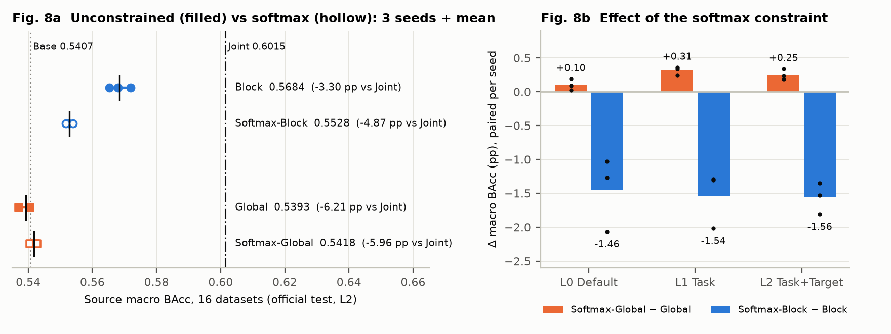

- **Ranking:** Specialist > Joint > Block > Softmax-Block holds in every seed. Below them, Softmax-Global and Base are tied (Softmax-Global − Base = +0.15 / −0.02 / +0.21 pp), followed by Global and Uniform.
- **Softmax-Block is the second-best merge:** it is 1.21 ± 0.11 pp above Base, but 1.56 pp below Block.
- **Softmax-Global vs Global:** +0.25 pp, so the constraint is neutral at global granularity. Neither global variant recovers more than 2 % of Joint's gain over Base.

**G.2 Paired comparisons** (same seed, official L2):

| Comparison (L2) | seed 0 | seed 1 | seed 2 | Mean ± std | Datasets improved (per seed) | Datasets improved (seed mean) |
|---|---:|---:|---:|---:|---:|---:|
| Softmax-Block − Block | -1.53 | -1.35 | -1.81 | -1.56 ± 0.23 | 4/6/3 of 16 | 4 of 16 |
| Softmax-Global − Global | +0.18 | +0.34 | +0.23 | +0.25 ± 0.08 | 8/9/6 of 16 | 9 of 16 |
| Softmax-Block − Softmax-Global | +1.05 | +1.13 | +1.11 | +1.10 ± 0.04 | 11/11/11 of 16 | 12 of 16 |
| Block − Global | +2.76 | +2.82 | +3.15 | +2.91 ± 0.21 | 13/10/13 of 16 | 13 of 16 |
| Softmax-Block − Base | +1.20 | +1.11 | +1.32 | +1.21 ± 0.11 | 12/11/11 of 16 | 12 of 16 |
| Softmax-Global − Base | +0.15 | -0.02 | +0.21 | +0.11 ± 0.12 | 10/9/10 of 16 | 10 of 16 |
| Softmax-Global − Uniform | +1.18 | +1.06 | +1.56 | +1.27 ± 0.26 | 12/11/12 of 16 | 10 of 16 |
| Softmax-Block − Joint | -5.12 | -4.70 | -4.78 | -4.87 ± 0.22 | 1/0/2 of 16 | 1 of 16 |

**By instruction level:**

| Comparison (pp) | L0 Default | L1 Task | L2 Task+Target |
|---|---:|---:|---:|
| Softmax-Block − Block | -1.46 ± 0.54 | -1.54 ± 0.42 | -1.56 ± 0.23 |
| Softmax-Global − Global | +0.10 ± 0.09 | +0.31 ± 0.06 | +0.25 ± 0.08 |
| Softmax-Block − Softmax-Global | +0.94 ± 0.15 | +1.35 ± 0.20 | +1.10 ± 0.04 |
| Block − Global | +2.50 ± 0.55 | +3.20 ± 0.17 | +2.91 ± 0.21 |

| Model | L0 Default | L1 Task | L2 Task+Target (main) | Δ vs Joint, L0 (pp) | Δ vs Joint, L1 (pp) | Δ vs Joint, L2 (pp) |
|---|---:|---:|---:|---:|---:|---:|
| Joint | 0.5545 ± 0.0019 | 0.5836 ± 0.0031 | 0.6015 ± 0.0026 | +0.00 | +0.00 | +0.00 |
| Block | 0.5510 ± 0.0045 | 0.5651 ± 0.0027 | 0.5684 ± 0.0034 | -0.35 | -1.85 | -3.30 |
| Softmax-Block | 0.5364 ± 0.0010 | 0.5497 ± 0.0018 | 0.5528 ± 0.0011 | -1.81 | -3.39 | -4.87 |
| Softmax-Global | 0.5270 ± 0.0021 | 0.5362 ± 0.0014 | 0.5418 ± 0.0012 | -2.75 | -4.74 | -5.96 |
| Global | 0.5260 ± 0.0013 | 0.5331 ± 0.0017 | 0.5393 ± 0.0019 | -2.85 | -5.05 | -6.21 |
| Base | 0.5058 ± 0.0000 | 0.5327 ± 0.0000 | 0.5407 ± 0.0000 | -4.87 | -5.09 | -6.08 |
| Uniform | 0.5172 ± 0.0025 | 0.5251 ± 0.0025 | 0.5292 ± 0.0017 | -3.73 | -5.85 | -7.23 |

- **The cost of the constraint at block granularity does not depend on the instruction level:** −1.46 / −1.54 / −1.56 pp at levels 0 / 1 / 2.
- **The level effect of Section A.3 carries over:** Softmax-Block's gap to Joint grows from −1.81 pp at level 0 to −4.87 pp at level 2, as Block's does (−0.35 → −3.30).

**G.3 Per dataset** (official L2, seed mean; SB − B and SG − G are paired per seed, mean ± std) (Fig. 9):

| Dataset | Base | Joint | Block | Softmax-Block | SB − B (pp) | Global | Softmax-Global | SG − G (pp) |
|---|---:|---:|---:|---:|---:|---:|---:|---:|
| MI_OpenBMI | 0.7354 | 0.7650 | 0.7385 | 0.7418 | +0.33 ± 1.00 | 0.7251 | 0.7308 | +0.57 ± 0.90 |
| MI_BCIC_IV2a | 0.4462 | 0.6178 | 0.6091 | 0.5402 | -6.88 ± 1.08 | 0.4783 | 0.5394 | +6.11 ± 0.99 |
| MI_ShanghaiU | 0.5357 | 0.5722 | 0.5727 | 0.5799 | +0.72 ± 1.39 | 0.5847 | 0.5865 | +0.18 ± 0.30 |
| MI_BCIC_Upperlimb | 0.4083 | 0.4650 | 0.4444 | 0.4425 | -0.19 ± 0.55 | 0.4319 | 0.4405 | +0.86 ± 0.17 |
| MI_HighGamma | 0.6020 | 0.7134 | 0.6317 | 0.6413 | +0.96 ± 3.84 | 0.5740 | 0.6098 | +3.58 ± 4.09 |
| MI_Cho2017 | 0.7139 | 0.7844 | 0.7500 | 0.7465 | -0.35 ± 0.42 | 0.7417 | 0.7417 | +0.00 ± 1.07 |
| MI_Shin2017A | 0.7056 | 0.7130 | 0.7306 | 0.6778 | -5.28 ± 2.21 | 0.7102 | 0.6945 | -1.57 ± 2.01 |
| MI_PhysioNet | 0.6878 | 0.7336 | 0.7041 | 0.6783 | -2.58 ± 0.17 | 0.6374 | 0.6524 | +1.50 ± 0.23 |
| EMO_FACED | 0.4042 | 0.3916 | 0.3304 | 0.2927 | -3.77 ± 0.20 | 0.2363 | 0.2647 | +2.85 ± 2.15 |
| EMO_SEED_3_seg4 | 0.5890 | 0.6873 | 0.6570 | 0.6262 | -3.08 ± 0.58 | 0.6270 | 0.6187 | -0.84 ± 0.17 |
| EMO_SEED_4_seg4 | 0.3757 | 0.4432 | 0.4185 | 0.4395 | +2.10 ± 0.87 | 0.4486 | 0.4372 | -1.14 ± 0.88 |
| EMO_SEED_5_seg4 | 0.3031 | 0.3817 | 0.3514 | 0.3478 | -0.36 ± 0.87 | 0.3490 | 0.3439 | -0.51 ± 0.65 |
| EMO_SEED_7_seg4 | 0.2524 | 0.3215 | 0.3055 | 0.3031 | -0.24 ± 1.05 | 0.3025 | 0.3035 | +0.09 ± 0.40 |
| SSVEP_OpenBMI | 0.5615 | 0.7550 | 0.5907 | 0.5793 | -1.14 ± 0.91 | 0.5710 | 0.5778 | +0.68 ± 1.62 |
| Workload | 0.6444 | 0.5667 | 0.5667 | 0.5176 | -4.91 ± 4.25 | 0.5796 | 0.5704 | -0.93 ± 3.12 |
| ADHD_AliMotie | 0.6853 | 0.7118 | 0.6933 | 0.6907 | -0.26 ± 2.33 | 0.6317 | 0.5580 | -7.37 ± 2.17 |
| **Macro** | 0.5407 | 0.6015 | 0.5684 | 0.5528 | -1.56 | 0.5393 | 0.5418 | +0.25 |

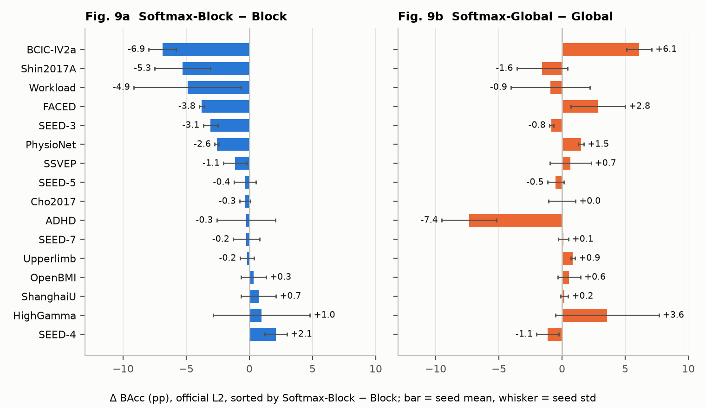

- **Softmax-Block is below Block on 12 of 16 datasets.** It is above Block only on OpenBMI (+0.33), ShanghaiU (+0.72), HighGamma (+0.96, std 3.84) and SEED-4 (+2.10).
- **Four datasets account for 84 % of the macro loss**, each with the same sign in all three seeds:
  - BCIC-IV2a −6.88 ± 1.08 pp;
  - Shin2017A −5.28 ± 2.21;
  - Workload −4.91 ± 4.25 (240 test trials);
  - FACED −3.77 ± 0.20.
- **On three of them, unconstrained Block was at or above Joint:**
  - IV2a: 0.6091 vs 0.6178;
  - Shin2017A: 0.7306 vs 0.7130;
  - Workload: 0.5667 vs 0.5667.

  The softmax loses most where Block did best.
- **Softmax-Block vs Base:** above Base on 12 of 16 datasets, against 14 of 16 for Block.
- **Softmax-Global vs Global:** the per-dataset changes are large but cancel in the macro.
  - Gains: IV2a +6.11, HighGamma +3.58 (std 4.09), FACED +2.85.
  - Losses: ADHD −7.37, Shin2017A −1.57.
  - Of note: the unconstrained Global gives the IV2a expert a negative weight (seed mean −0.066), and Softmax-Global gives it 0.011 (G.6).

**G.4 Supplementary protocol** (`eval_poc.py`, source macro, mean ± std over 3 seeds):

| Model | BAcc | Kappa | AUROC | wF1 | CE |
|---|---:|---:|---:|---:|---:|
| Specialist | 0.6314 ± 0.0016 | 0.4288 ± 0.0030 | 0.7697 ± 0.0008 | 0.6397 ± 0.0021 | 0.9438 ± 0.0030 |
| Joint | 0.6022 ± 0.0026 | 0.3790 ± 0.0038 | 0.7469 ± 0.0018 | 0.6118 ± 0.0022 | 0.9673 ± 0.0015 |
| Block | 0.5677 ± 0.0025 | 0.3244 ± 0.0029 | 0.7241 ± 0.0013 | 0.5765 ± 0.0025 | 0.9943 ± 0.0015 |
| Softmax-Block | 0.5527 ± 0.0012 | 0.2988 ± 0.0015 | 0.7131 ± 0.0012 | 0.5580 ± 0.0021 | 1.0093 ± 0.0021 |
| Softmax-Global | 0.5424 ± 0.0017 | 0.2796 ± 0.0036 | 0.7010 ± 0.0042 | 0.5371 ± 0.0041 | 1.0247 ± 0.0026 |
| Global | 0.5397 ± 0.0026 | 0.2765 ± 0.0054 | 0.7024 ± 0.0016 | 0.5351 ± 0.0034 | 1.0256 ± 0.0021 |
| Base | 0.5385 ± 0.0000 | 0.2778 ± 0.0000 | 0.6973 ± 0.0000 | 0.5268 ± 0.0000 | 1.0345 ± 0.0000 |
| Uniform | 0.5294 ± 0.0025 | 0.2595 ± 0.0040 | 0.6925 ± 0.0012 | 0.5199 ± 0.0020 | 1.0324 ± 0.0019 |

- **On every metric, Block > Softmax-Block > both global merges.** These metrics are BAcc, Kappa, AUROC, wF1 and CE.
- **Softmax-Global and Global are within 0.004 of each other on every metric.**

**External Weibo** (supplementary protocol, all 10 subjects):

| Model | BAcc | Kappa | AUROC | CE |
|---|---:|---:|---:|---:|
| Joint | 0.6247 ± 0.0089 | 0.2494 ± 0.0179 | 0.6918 ± 0.0095 | 0.6827 ± 0.0104 |
| Base | 0.6228 ± 0.0000 | 0.2456 ± 0.0000 | 0.6971 ± 0.0000 | 0.6544 ± 0.0000 |
| Block | 0.6205 ± 0.0057 | 0.2409 ± 0.0114 | 0.6849 ± 0.0101 | 0.6759 ± 0.0084 |
| Softmax-Block | 0.6196 ± 0.0071 | 0.2392 ± 0.0144 | 0.6742 ± 0.0038 | 0.6708 ± 0.0047 |
| Uniform | 0.6068 ± 0.0078 | 0.2135 ± 0.0156 | 0.6854 ± 0.0018 | 0.6766 ± 0.0037 |
| Global | 0.6057 ± 0.0128 | 0.2114 ± 0.0257 | 0.6903 ± 0.0062 | 0.6737 ± 0.0080 |
| Softmax-Global | 0.6047 ± 0.0064 | 0.2093 ± 0.0127 | 0.6899 ± 0.0048 | 0.6723 ± 0.0035 |

- **Softmax-Block, Block and Base are tied:** 0.6196 / 0.6205 / 0.6228, within one seed std.
- **Softmax-Global (0.6047) is with Global and Uniform**, about 1.8 pp below Base.

**G.5 Validation and selection** (Fig. 10; 1 epoch over the 512-sample calibration set = 64 steps):

| Merge | Selected step (s0/s1/s2) | Selected val BAcc | Gain at step 160 (pp) | Share of final gain at step 160 | Gain after step 160 (pp) |
|---|---:|---:|---:|---:|---:|
| Global | 960 / 1280 / 320 | 0.5964 / 0.5939 / 0.5954 | +0.82 / +0.68 / +1.70 | 78 % / 54 % / 95 % | +0.23 / +0.58 / +0.08 |
| Softmax-Global | 480 / 640 / 1280 | 0.5956 / 0.5921 / 0.5956 | +0.90 / +1.03 / +0.79 | 93 % / 96 % / 44 % | +0.07 / +0.04 / +1.02 |
| Block | 1600 / 1280 / 1120 | 0.6259 / 0.6265 / 0.6263 | +3.37 / +4.21 / +3.88 | 84 % / 93 % / 80 % | +0.63 / +0.31 / +0.99 |
| Softmax-Block | 1440 / 1600 / 1440 | 0.6108 / 0.6148 / 0.6143 | +1.24 / +1.72 / +1.84 | 50 % / 51 % / 50 % | +1.24 / +1.63 / +1.83 |

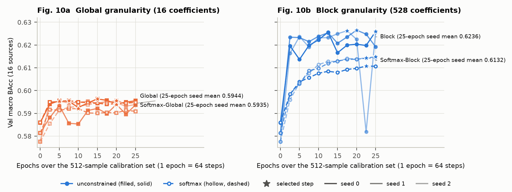

- **Softmax-Block is still improving at the end of the budget:**
  - It is selected at steps 1440 / 1600 / 1440, the last two evaluations.
  - Its validation BAcc rises in 8 / 10 / 8 of the 10 evaluation intervals.
  - Only 50–51 % of its final gain is reached at step 160, against 80–93 % for Block.
  - Plausible cause (not tested): Adam moves each β by about lr per step, which moves α by only about α · lr ≈ lr / 16. Block's Adam moves α itself by about lr per step.
- **Softmax-Block's selected validation BAcc (0.6133 seed mean) is 1.29 pp below Block's (0.6262).** The test gap is 1.56 pp.
- **Softmax-Global plateaus like Global**, with 93 / 96 / 44 % of its final gain reached at step 160. Its selected validation (0.5944) equals Global's (0.5952) within noise.
- **Read with care:** all comparisons here are at the equal 1,600-step budget used for Block. A longer budget or a larger lr for β could narrow Softmax-Block's gap. Neither was run, because extra tuning was not requested.

**G.6 Learned weights**

**Softmax-Global** (16 weights, each seed sums to 1):

| Expert | Softmax-Global α (s0 / s1 / s2) | mean | Global α (unconstrained), mean |
|---|---:|---:|---:|
| MI_OpenBMI | 0.097 / 0.112 / 0.033 | 0.081 | +0.108 |
| MI_BCIC_IV2a | 0.014 / 0.014 / 0.004 | 0.011 | -0.066 |
| MI_ShanghaiU | 0.019 / 0.020 / 0.004 | 0.014 | +0.011 |
| MI_BCIC_Upperlimb | 0.039 / 0.024 / 0.141 | 0.068 | +0.104 |
| MI_HighGamma | 0.019 / 0.013 / 0.005 | 0.012 | +0.028 |
| MI_Cho2017 | 0.050 / 0.064 / 0.060 | 0.058 | +0.037 |
| MI_Shin2017A | 0.032 / 0.027 / 0.121 | 0.060 | +0.096 |
| MI_PhysioNet | 0.039 / 0.024 / 0.016 | 0.026 | +0.023 |
| EMO_FACED | 0.053 / 0.060 / 0.046 | 0.053 | +0.106 |
| EMO_SEED_3_seg4 | 0.080 / 0.060 / 0.015 | 0.052 | +0.095 |
| EMO_SEED_4_seg4 | 0.194 / 0.153 / 0.111 | 0.153 | +0.190 |
| EMO_SEED_5_seg4 | 0.135 / 0.121 / 0.163 | 0.140 | +0.155 |
| EMO_SEED_7_seg4 | 0.099 / 0.137 / 0.174 | 0.137 | +0.132 |
| SSVEP_OpenBMI | 0.054 / 0.097 / 0.028 | 0.060 | +0.115 |
| Workload | 0.036 / 0.039 / 0.016 | 0.030 | +0.099 |
| ADHD_AliMotie | 0.039 / 0.036 / 0.061 | 0.045 | +0.139 |
| **Sum** | 1.000 / 1.000 / 1.000 | 1.000 | +1.372 |

- **Weights range from 0.004 to 0.194**, which corresponds to 8.6–10.5 effective experts (1 / Σα²; uniform = 16).
- **The emotion experts get the largest weights:** SEED-4 0.153, SEED-5 0.140, SEED-7 0.137.
- **IV2a, HighGamma and ShanghaiU are nearly switched off:** 0.011–0.014.
- **The weights correlate with the unconstrained Global α** at r = 0.76 / 0.69 / 0.85 within each seed. The cross-seed correlations are 0.90 / 0.53 / 0.52.

**Softmax-Block** (Fig. 11; 33 groups × 16 experts; each group sums to 1):

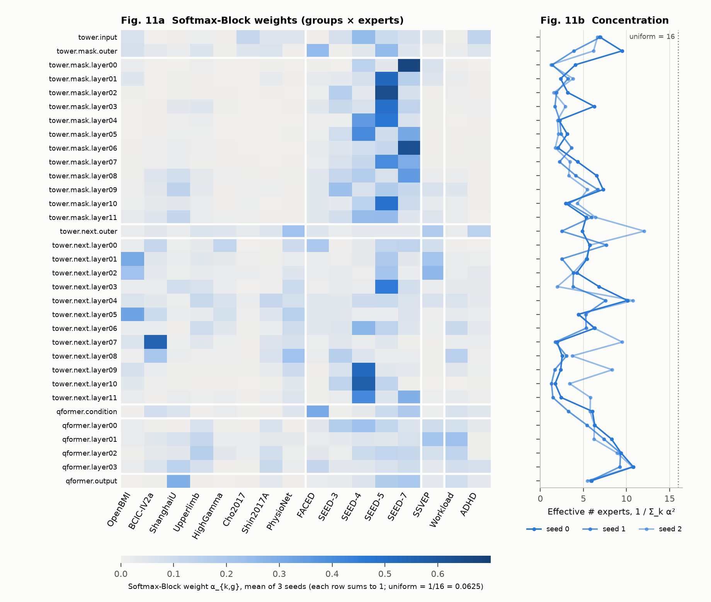

- **Much more concentrated than Softmax-Global:**
  - The mean effective number of experts per group is 4.9, ranging from 1.2 to 12.1.
  - In 12 of 33 groups, the largest weight, averaged over seeds, is above 0.5.
  - The largest single weight is 0.905.
- **The emotion experts dominate the EEG tower.** In the input and mask-branch groups, the 5 emotion experts hold 0.79 of the weight, against 0.31 under uniform weighting. The Q-Former is more mixed:

| Expert family | Uniform share | tower input + mask branch (14) | tower next branch (13) | Q-Former (6) |
|---|---:|---:|---:|---:|
| MI (8 experts) | 0.500 | 0.150 | 0.430 | 0.330 |
| Emotion (5) | 0.312 | 0.788 | 0.431 | 0.447 |
| SSVEP (1) | 0.062 | 0.027 | 0.068 | 0.077 |
| Workload + ADHD (2) | 0.125 | 0.035 | 0.071 | 0.146 |

- **Identifiability:**
  - The top expert of a group is the same in all three seeds for 7 of 33 groups.
  - The full weight matrix correlates across seeds at r = 0.60 / 0.52 / 0.60, higher than Block's α (0.39 / 0.45 / 0.45).
  - Within a seed, it correlates with Block's α at only r = 0.27–0.34.
- **SSVEP**, the largest single source of the gap to Joint (B.4), never gets more than 0.08 of a region's weight on average.

Per-group detail (✓ = same top expert in all seeds):

| Group | Effective # experts (s0/s1/s2) | Largest weight (s0/s1/s2) | Top expert (s0/s1/s2) |
|---|---:|---:|---|
| tower.input | 6.9 / 7.0 / 6.6 | 0.28 / 0.22 / 0.25 | SEED-4 / SEED-4 / SEED-4 ✓ |
| tower.mask.outer | 9.5 / 3.9 / 6.2 | 0.16 / 0.39 / 0.31 | FACED / SEED-5 / FACED |
| tower.mask.layer00 | 4.1 / 1.4 / 1.2 | 0.39 / 0.85 / 0.90 | SEED-4 / SEED-7 / SEED-7 |
| tower.mask.layer01 | 2.3 / 3.2 / 3.8 | 0.64 / 0.52 / 0.43 | SEED-5 / SEED-5 / SEED-5 ✓ |
| tower.mask.layer02 | 3.2 / 1.9 / 1.6 | 0.40 / 0.72 / 0.79 | SEED-5 / SEED-5 / SEED-5 ✓ |
| tower.mask.layer03 | 6.2 / 1.7 / 2.9 | 0.29 / 0.76 / 0.54 | SEED-7 / SEED-5 / SEED-5 |
| tower.mask.layer04 | 2.2 / 2.2 / 2.0 | 0.66 / 0.62 / 0.69 | SEED-4 / SEED-5 / SEED-5 |
| tower.mask.layer05 | 3.1 / 2.4 / 2.1 | 0.53 / 0.61 / 0.67 | SEED-4 / SEED-4 / SEED-7 |
| tower.mask.layer06 | 2.1 / 3.6 / 1.7 | 0.68 / 0.45 / 0.75 | SEED-7 / SEED-7 / SEED-7 ✓ |
| tower.mask.layer07 | 4.3 / 2.2 / 3.4 | 0.32 / 0.65 / 0.47 | SEED-5 / SEED-5 / SEED-7 |
| tower.mask.layer08 | 6.5 / 4.1 / 3.3 | 0.30 / 0.45 / 0.50 | SEED-4 / SEED-7 / SEED-7 |
| tower.mask.layer09 | 7.3 / 6.7 / 5.5 | 0.27 / 0.26 / 0.29 | SEED-3 / ShanghaiU / SEED-3 |
| tower.mask.layer10 | 2.9 / 3.3 / 4.3 | 0.57 / 0.52 / 0.39 | SEED-5 / SEED-5 / SEED-5 ✓ |
| tower.mask.layer11 | 5.3 / 6.0 / 6.4 | 0.31 / 0.31 / 0.28 | SEED-4 / SEED-5 / SEED-4 |
| tower.next.outer | 4.9 / 2.5 / 12.1 | 0.35 / 0.61 / 0.12 | ADHD / PhysioNet / Shin2017A |
| tower.next.layer00 | 5.7 / 7.7 / 5.8 | 0.29 / 0.23 / 0.29 | FACED / SEED-5 / SEED-7 |
| tower.next.layer01 | 5.4 / 2.5 / 5.3 | 0.33 / 0.62 / 0.38 | SEED-5 / OpenBMI / SSVEP |
| tower.next.layer02 | 4.2 / 3.8 / 3.8 | 0.43 / 0.48 / 0.41 | SSVEP / SEED-5 / OpenBMI |
| tower.next.layer03 | 6.8 / 3.8 / 2.0 | 0.23 / 0.45 / 0.71 | ShanghaiU / SEED-5 / SEED-5 |
| tower.next.layer04 | 10.1 / 7.6 / 10.8 | 0.16 / 0.21 / 0.16 | OpenBMI / SEED-4 / Upperlimb |
| tower.next.layer05 | 4.4 / 5.3 / 4.4 | 0.43 / 0.38 / 0.42 | OpenBMI / PhysioNet / OpenBMI |
| tower.next.layer06 | 6.3 / 5.3 / 6.2 | 0.27 / 0.36 / 0.31 | SEED-4 / SEED-4 / SEED-5 |
| tower.next.layer07 | 1.9 / 1.7 / 9.5 | 0.71 / 0.76 / 0.19 | BCIC-IV2a / BCIC-IV2a / BCIC-IV2a ✓ |
| tower.next.layer08 | 2.5 / 3.0 / 3.7 | 0.61 / 0.54 / 0.44 | PhysioNet / BCIC-IV2a / Workload |
| tower.next.layer09 | 2.4 / 1.7 / 8.3 | 0.62 / 0.77 / 0.20 | SEED-4 / SEED-4 / PhysioNet |
| tower.next.layer10 | 1.7 / 1.3 / 3.4 | 0.75 / 0.88 / 0.39 | SEED-4 / SEED-4 / SEED-3 |
| tower.next.layer11 | 2.4 / 1.5 / 5.8 | 0.63 / 0.83 / 0.32 | SEED-7 / SEED-4 / SEED-4 |
| qformer.condition | 6.0 / 3.3 / 5.8 | 0.31 / 0.52 / 0.34 | FACED / FACED / SEED-7 |
| qformer.layer00 | 6.3 / 5.4 / 6.3 | 0.31 / 0.37 / 0.31 | SEED-4 / SEED-3 / SEED-4 |
| qformer.layer01 | 8.3 / 7.4 / 6.2 | 0.21 / 0.27 / 0.31 | SSVEP / SSVEP / Workload |
| qformer.layer02 | 9.4 / 9.3 / 8.9 | 0.17 / 0.18 / 0.18 | Upperlimb / Upperlimb / Workload |
| qformer.layer03 | 10.8 / 9.2 / 10.7 | 0.17 / 0.21 / 0.17 | ShanghaiU / ShanghaiU / FACED |
| qformer.output | 5.9 / 5.8 / 5.5 | 0.30 / 0.27 / 0.30 | ShanghaiU / ShanghaiU / ShanghaiU ✓ |

**G.7 K = 5 vs K = 16**

The round-2 K = 5 result is a single seed with 1,000-step experts, so it is not directly comparable to poc16. The 3,000-step K = 5 run (`runs/poc3k`) has no softmax merges, but its Block coefficients are a useful reference.

| Setting | Experts | Seeds | SB − B (pp) | SG − G (pp) | Block: mean per-group Σα | Block: max per-group Σα | Block: share of α < 0 |
|---|---|---:|---:|---:|---:|---:|---:|
| `runs/poc` (round 2) | 5, 1,000 steps | 1 | -0.47 | -0.54 | 1.71 | 3.13 | 15 % |
| `runs/poc3k` | 5, 3,000 steps | 3 | not run | not run | 1.42 | 4.30 | 24 % |
| `runs/poc16` (this round) | 16, 3,000 steps | 3 | -1.56 | +0.25 | 1.65 | 7.42 | 38 % |

- **The cost of the constraint at block granularity grows with K:** −0.47 pp at K = 5 (one seed) and −1.56 ± 0.23 pp at K = 16.
- **What the softmax rules out is more prominent at K = 16:**
  - The mean per-group Σα of Block is similar in all three settings (1.42–1.71).
  - But its spread is much wider at K = 16: the maximum per-group Σα is 3.1 / 4.3 / 7.4 in `runs/poc` / `runs/poc3k` / `runs/poc16`.
  - The share of negative α is 15 / 24 / 38 %.
  - Both of these are impossible under the softmax. This is a correlation across three settings, not a causal test.

**G.8 Conclusions**

1. **At K = 16 and equal budget, the convex (softmax) constraint does not help.**
   - At block granularity it costs 1.56 ± 0.23 pp, in every seed and at every level.
   - At global granularity it is neutral: +0.25 pp, and tied with Base.
   - Unconstrained Block remains the best merge.
2. **The loss is concentrated where Block was strongest.** IV2a, Shin2017A and Workload are the datasets where Block was at or above Joint.
3. **This is consistent with the F.5 hypothesis** (interpretation, not tested): what Block adds over a plain average is mostly the freedom to rescale groups and to subtract experts. The softmax removes exactly this freedom. The proposed per-group scale λ_g on Σδ (33 coefficients) remains the direct test.
4. **Softmax-Block had not converged within the 1,600-step budget.** Its accuracy here is a lower bound on what a longer-trained softmax merge could reach, so the 1.56 pp cost may be an overestimate.

---

## 3. Caveats

- **Seeds and std:**
  - Three seeds, with the sample std (ddof = 1). A seed changes experts, Joint, calibration subsets and merge order together, so the std mixes all of these sources.
  - Base has no variance; its std is 0 by construction.
- **Small test sets:** Workload (240), Shin2017A (360) and ADHD (599). Their per-dataset results have 2–4 pp seed std and should not be over-read.
- **Specialist** is 16 separate models, a reference only.
- **Budgets:**
  - Joint and the SSVEP expert are selected at or near the last validation, so a larger training budget could change them.
  - The merge budget is not the limiting factor for Block and Global: their validation plateaus by step 160–320.
  - It may be for Softmax-Block, whose validation was still rising at step 1,600 (G.5). The softmax round uses the same budget as Block, not a tuned one.
- **Validation vs test:** validation is 5–9 pp above test for every model, and the validation gap to Joint is larger than the test gap. The validation numbers should only be compared within the validation table.
- **Weibo** uses only the supplementary protocol, has 10 subjects and has no Specialist row.
- **The K = 5 vs K = 16 comparison** changes the Joint training set and the merge set together, by design. Per-dataset budgets are equal, but Joint's total number of steps differs (15k vs 48k).
- **The softmax K = 5 reference (G.7)** is a single seed with 1,000-step experts (`runs/poc`); `runs/poc3k` has no softmax merges.
- **Data use:** test data were used only for the final evaluation; selection used source validation only.

## 4. File index

| Path (under `LEAF/runs/poc16/`) | Content |
|---|---|
| `POC16_Three_Seed_Report.md` | this report |
| `direct_results_seeds.csv` / `.json` | official test, 3-seed mean ± std per (model, dataset, level), paired Δ vs Joint, per-seed BAcc |
| `results_seeds.csv` / `.json` | supplementary protocol, 3-seed aggregate (BAcc, Kappa, AUROC, wF1, CE; Weibo) |
| `seed{0,1,2}/direct_results.csv`, `seed{0,1,2}/results.csv` | per-seed official and supplementary tables |
| `seed0/direct_results_16sources.csv` | seed 0 official table restricted to the 16 sources (used for the aggregate) |
| `seed{0,1,2}/experts/<dataset>/`, `seed{0,1,2}/joint/` | `best.ckpt`, `history.json`, `metrics.npz`, `run.json` |
| `seed{0,1,2}/merge_{uniform,global,block}/` | `merged.ckpt` (plain LEAF checkpoint), `best_alpha.npy`, `alpha.csv`, `alpha_heatmap.png`, `history.json`, `metrics.npz`, `calibration_indices.npz`, `run.json` |
| `seed{0,1,2}/direct_inference/` | raw `c_direct_inference.py` CSV/JSON/log per checkpoint |
| `seed{0,1,2}/logs/`, `seed{0,1,2}_driver.log`, `chain*.log`, `aggregate_*.log` | run logs |
| `chain_after_poc3k.sh`, `chain_seeds12.sh` | the exact command sequences (seed 0; seeds 1–2 + aggregation) |
| `figures/fig1–fig11*.png` | figures of this report (Figs. 8–11: Section G) |
| `analysis/poc16_analysis.py`, `analysis/poc16_analysis.json` | script that produced the tables and figures of Sections 0–F, and its numeric output |
| `analysis/poc16_softmax_analysis.py`, `analysis/poc16_softmax_analysis.json` | the same for Section G |
| `seed{0,1,2}/merge_softmax_{global,block}/` | softmax merges (same files as the other merges; `metrics.npz` also has `logit_history` of β) |
| `seed{0,1,2}/direct_results_softmax.csv`, `seed{0,1,2}/results_softmax.csv` | per-seed official table with the softmax rows added; supplementary table (Base, Joint, Softmax-Global, Softmax-Block, Weibo) |
| `direct_results_seeds_softmax.csv` / `.json`, `results_seeds_softmax.csv` / `.json` | 3-seed aggregates of the two tables above |
| `chain_softmax.sh`, `chain_softmax.log` | the softmax-round command sequence and its log |
| `../poc3k/` | 5-dataset, 3-seed run used in Section F |
